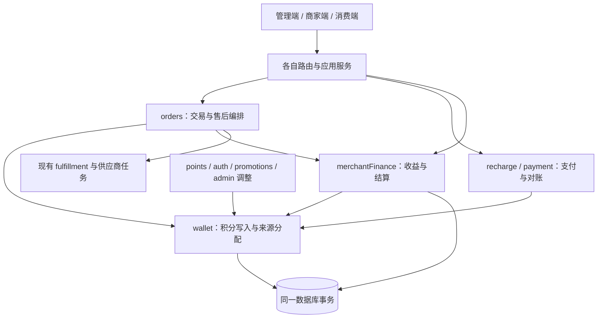

# MoNexus 交易、积分来源、商家结算与运营闭环实施方案

版本：评审稿 v1.0｜日期：2026-11-10｜交付方式：同一开发批次、一个 PR

代码基线：远程 `origin/develop`，提交 `9a579fbe42ddcb30c2beced7862477c89a0063a0`。以下现状均针对该提交；文件行号随开发可能变化，应以符号名核对。

本文是实施方案，尚未修改业务代码，也不代表启用真实充值、确定积分兑价或承诺商家提现。

## 1. 本批要达到什么结果

MoNexus 本阶段定位为：管理员运营、商家提供数字商品或服务、消费者购买的平台。消费者可通过真实支付取得积分，使用积分购买；商家在交易完成并通过结算后获得积分收益。当前阶段继续允许商家使用已入账积分消费。

将前述四项放入同一批开发：①交易规则与收益口径；②积分来源、冻结分配及原路退款；③商家收益、结算批次及冲正；④支付对账与履约异常处理。它们共同解决一个问题：**一笔交易从哪里获得支付能力、付给谁、发生异常后由谁承担，系统能够解释并执行。**

完成之后，应能够顺着一笔订单查看充值或奖励来源、实际扣款、交付、商家应得、结算入账和售后调整，也能够从支付异常或履约异常反向找到处理入口。无需管理员到数据库里修改余额或订单状态。

### 1.1 明确边界

| 本批交付 | 本批不交付 |
|---|---|
| 积分来源与分配、冻结与退款闭环 | 商家银行卡提现、自动打款、支付机构分账接入 |
| 商家净收益、真实可结算条件、可追踪结算批次 | 将商家全部积分余额解释成现金债权 |
| 已结算订单的管理员售后调整与商家追偿 | 消费者自助部分退款、任意比例分摊引擎 |
| 支付对账、恢复处理、履约诊断与已有安全动作 | 通用工单平台、通用工作流引擎、统一重写所有供应商任务 |
| 现有业务模块之间的清晰边界 | 微服务、多租户、插件市场、多币种金融平台 |

一个 PR 内可分多个提交、按依赖顺序实施和启用，但最终以四项完整交付进行评审。生产政策未确定时，相关真实资金入口继续受已有开关保护，不以缺少政策配置阻断结构性代码的交付。

## 2. 对当前项目的判断

现有系统已具备订单、冻结扣款、履约任务、充值确认、退款、支付争议及人工审查等基础。问题主要是“资金事实散在业务代码中，模块边界与运营闭环没有收拢”，不需要推翻重写。

| 已核实的现状 | 本批处理方式 |
|---|---|
| `PointAccount` 只有可用、冻结和隔离的 sandbox 余额；`PointLog` 没有消费来源分配 | 保留账户作为余额投影，新增来源和分配记录 |
| `points/checkedMutation.ts` 已有条件更新和上限检查，但日志由各业务自行写入 | 将余额、来源、分配和日志合并为 wallet 的一次原子写入 |
| 批量结算已在一个事务中给商家真实入账，并使用 `settlement_in` | 保留行为，迁移所有权，增加批次与逐项凭证；历史已入账不能再发一次 |
| `Settlement` 已按订单唯一，记录订单额、佣金及商家净额 | 继续作为每笔订单应结收益的权威记录，不再新增一套平行的 MerchantEarning |
| 商家首页累计收益包含作废记录，待结算与真实可结算条件不一致 | 建立统一读模型，所有页面使用一致口径 |
| 等级与排行榜使用正向 `in`，充值也写 `in` | 改用明确的增长资格事实，避免充值被算成奖励所得 |
| 订单关闭后是终态，已结算退款被阻止 | 增加独立售后调整，不重新打开终态订单 |
| 已有支付对账服务、恢复案件及履约审查页面 | 扩展现有能力和页面，不另建一套运营系统 |

主要出处：`schema.prisma:502、512、1253、2389`；`admin/settlementAdmin.ts:56–166`；`merchant/dashboardQueries.ts:33–39`；`orders/accounting.ts:176–185`；`payment/reconciliation/service.ts`。完整文件索引见第 14 节。

## 3. 先写清交易规则，再让代码表达规则

### 3.1 建议采用的规则草案

以下是本方案推荐默认值，并非用户已经确认的商业政策。实现时以显式配置、版本和快照表达，不把示例兑换比例写死。

| 问题 | 建议规则 | 实施含义 |
|---|---|---|
| 商家赚到什么 | 本批为可在平台消费的结算积分 | 页面称“积分收益”“已入账积分”，不显示“可提现现金” |
| 奖励积分能否支付 | 可允许，但奖励部分由平台承担补贴责任 | 消费分配必须知道奖励来源，结算保留资金构成快照 |
| 商家是否因奖励支付少拿收益 | 推荐同商品同价、同佣金规则 | 不在结算时临时折损商家净额；平台补贴列入运营报表 |
| 佣金基数 | 推荐按订单成交积分额，按原有整数规则计算 | 下单快照固定；不读取结算当天新费率重算 |
| 消费先使用何种来源 | 推荐所有可消费来源统一按入账时间、ID 顺序分配 | 简单、稳定、可解释；来源类别不自动对应提现资格 |
| 退款返还什么 | 按原消费分配恢复相同来源 | 奖励仍是奖励，历史未知仍是未知，不能洗成充值积分 |
| 已结算全额售后 | 买家退款与商家冲正分别记事实 | 商家余额不足不抹掉已批准的买家退款 |
| 已结算部分退款 | 本批暂不开放 | 明确返回不支持；不得按前端金额任意扣款 |
| 历史收益与来源 | 可证明的保留；不可证明的标记未知 | 不将所有余额或历史收益强行认定为充值资金 |

奖励补贴需要记录“谁承担、承担多少、依据什么政策”。本批不建设自动预算平台；新增奖励政策的规模和支付范围继续使用显式开关及现有配置控制。若没有奖励支付政策，则不擅自扩大现有奖励使用范围；存量用户权益的调整需要另行明确，不能在迁移中静默削减。

### 3.2 用一个例子约束实现

消费者支付一笔 1,000 积分订单，其中充值来源 700、奖励来源 300，佣金示例为 10%。则订单额 1,000、佣金 100、商家应得 900。平台需要能够说明这 300 积分的奖励支付责任；它不是支付机构真实收到的现金。

全额退款时，消费者恢复原 700 充值来源和 300 奖励来源。尚未结算则取消应结收益；已经结算则另记商家净额冲正 900、佣金冲正 100。不能向商家追收订单总额 1,000，也不能把奖励退款改成充值款。

上例数字只说明关系，不确定生产费率、积分兑价或现金清算金额。涉及充值现金退款时，应依据原充值单的真实支付金额、已退款额和价格快照处理。

### 3.3 必须分开的概念

**充值金额、积分面额、商家净收益、商家钱包余额和将来可提现金额，是五个不同概念。** 例如商家获得 900 积分后消费 400，累计收益仍为 900，钱包可用余额可能只剩 500；不能再根据累计收益承诺提现 900。

订单已有 ValuePolicy/定价快照与充值已有 RechargePricePolicy 应分别保留。新增来源记录只引用其版本和业务凭证，不另造第三套兑换政策。缺少历史兑价时显示未知，不用当前比例补算历史现金收入。

## 4. 高内聚、低耦合的模块设计

保留模块化单体和同一个 PostgreSQL。把事务做短，把职责收拢，而不是通过微服务或通用事件总线制造新的协调成本。



箭头表示调用方向。wallet 不导入订单、充值、支付、商家财务或奖励业务；merchantFinance 不导入订单工作流。领域编排由上层服务负责。

### 4.1 wallet：唯一积分写入所有者

新增 `server/src/modules/wallet/`，内部按职责划分 `commands.ts`、`allocation.ts`、`queries.ts`、`types.ts`、`index.ts`，无需为每个函数增加 repository/service/factory 三层包装。

wallet 负责：账户变动、来源批次、分配、冻结、消耗、释放、原来源返还、对应 PointLog 和幂等结果。它只校验积分层约束，不判断订单是否可退款、商家是否可结算、支付是否成功。

公开接口使用清晰的专用命令，例如 `creditInTx`、`spendInTx`、`reserveInTx`、`captureInTx`、`releaseInTx`、`refundInTx`。所有变更必须传 `Prisma.TransactionClient`，由调用方提供稳定业务标识、操作幂等键、操作者和原因码。对外不暴露“任意修改账户余额”或任意 signed delta 接口。

接口契约示意：

```ts
type WalletContext = {
  tx: Prisma.TransactionClient
  operationKey: string
  actorUserId?: number
  source: { kind: WalletSourceKind; id: string }
  reasonCode: WalletReasonCode
}
// refundInTx 必须引用原 consume operation，不接受任意来源类别。
// 相同 operationKey 与相同参数重放返回原结果；参数冲突则报错。
```

`source.id` 采用字符串，兼容整数订单 ID 和 UUID 支付凭证，不能沿用所有 ID 都是 UUID 的假设。类型字段使用受控联合类型；数据库对通用引用无法建立真实外键，因此重要关系另有显式外键，不能只依赖这两个字符串。

原 `points/checkedMutation.ts` 的条件更新、余额上限和隔离 sandbox 逻辑可迁入 wallet 内部，或短期作为受限兼容门面。不能继续允许业务调用低层余额函数后自行创建 PointLog。`orders/accounting.ts` 保留订单会计编排，只调用 wallet，不再担任全站积分工具箱。

### 4.2 merchantFinance：唯一收益和结算所有者

新增顶层 `modules/merchantFinance/`，管理 Settlement 创建与作废、资格判定、结算批次、结算入账、售后收益调整及商家欠收。商家自助模块 `merchant/` 继续负责商家资料和界面用例，不承载后台财务核心。

将纯函数 `getSettlementEligibility` 迁入 merchantFinance。订单模块可传入订单状态调用此函数；财务模块在结算时读取订单事实并加锁复核，但不能回调订单取消、仲裁、履约工作流。

原 Settlement 仍是订单应结收益权威。批次项记录某次执行向哪个账户入账多少，Adjustment 记录之后发生的变化。收益查询从这些事实派生；不创建另一张同义的“收益主表”再同步 Settlement。

公开财务接口按用例划分为 `createSettlementInTx`、`voidUnsettledInTx`、`executeBatch`、`reverseForAfterSalesInTx` 和只读 summary/list/detail。订单内的命令共享调用方事务；独立批量结算由 finance 应用服务开事务并完成业务根锁。返回结构包括实际 operationId、批次/调整 ID、执行金额及阻止原因，不返回可供其他模块随意修改的内部实体。

### 4.3 orders、recharge、运营端各自保留什么

- orders：订单状态、支付积分的时点、交付证据、是否允许取消或售后，以及 wallet 与 merchantFinance 的同事务编排。
- recharge/payment：支付观察、确认、真实现金退款、支付争议、充值撤销和对账。支付渠道调用与签名验证不进入 wallet。
- points/auth/promotions：奖励资格、签到规则、活动计费等业务规则。它们提交明确的积分命令，不能自行更新账户和日志。
- 管理端：鉴权、MFA、输入校验和 DTO。页面展示后端计算的 allowedActions，不能复制财务状态机。

暂不建立公共“万能账务模块”、业务插件回调、动态策略 DSL 或跨域全局事件总线。需要外部异步动作时沿用项目现有任务/重试机制，只在确有缺口的具体动作上增加持久化任务。

## 5. 数据设计：来源和变动可解释，余额可验证

### 5.1 wallet 的最小新增模型

| 模型 | 主要字段与约束 | 职责 |
|---|---|---|
| WalletOperation | id、全局唯一 operationKey、kind、userId、requestHash、业务引用、actor、结果余额、pointLogId | 一次成功积分操作及重放结果；持久化后不覆盖经济含义 |
| PointLot | userId、originKind、sourceOperationId、issuedPoints、availablePoints、frozenPoints、consumedPoints、policyVersion | 一个原始入账来源；计数是事务内维护的投影 |
| WalletAllocation | operationId、lotId、availableDelta、frozenDelta、consumedDelta、原冻结或消费 allocationId | 不可变的来源变动明细；记录如何冻结、扣除及返还 |

来源类别建议限定为 `recharge`、`reward`、`merchant_settlement`、`admin_adjustment`、`legacy_unknown`。奖励原因另有明确 reasonCode，不靠中文 reason 文案解析来源。sandbox 继续独立，不混入真实积分 lot。

一个新入账 operation 创建一个 lot，或按明确来源拆分多个 lot。冻结只是同一 lot 的 available 减少、frozen 增加；扣除冻结为 frozen 减少、consumed 增加；直接消费为 available 减少、consumed 增加；退款按原消费分配做反向变动。这里 consumed 表示已离开账户可支配范围，实际原因由 operation 区分，不等于全部都是商品销售额。

充值现金退款成功后的积分撤销也表现为 available/frozen 转入 consumed，operation.kind 标记 recharge_reversal；issuedPoints 仍是历史发行量，不减少。消费、渠道撤销和管理员扣除必须按 kind 分开统计。已被现金退款撤销的 allocation 不能再被普通商品退款引用返还。

每个 lot 满足：

```text
issuedPoints = availablePoints + frozenPoints + consumedPoints
PointAccount.balance = 同用户所有真实 lot.availablePoints 之和
PointAccount.frozenBalance = 同用户所有真实 lot.frozenPoints 之和
```

`issuedPoints` 不能通过修改原记录扩容；新增发放必须创建新 operation。退款恢复原 lot，不再增加 issuedPoints。每个正常 operation 的 allocation 增量与操作金额一致；初始化迁移 operation 单独标记，不伪装成业务收入。

涉及返还的行必须引用原 allocation；在账户锁内验证累计已捕获、释放、返还数量，累计不能超过原始数量。冻结通过 reserve operation 聚合识别，不再引入第二套可以独立写余额的 hold 主账。

PointAccount 是在线余额投影，PointLot 计数是来源余额投影，WalletAllocation 是可重建的变动依据，三者必须同事务更新。对账任务检查差异、生成异常，不自动选择一个余额覆盖另一个。

### 5.2 数据完整性要求

- 保持现有整数积分和安全上限；单笔及账户运算都校验非负、上限和整型范围，累计报表使用足够宽的数据库聚合及序列化方式。
- `operationKey` 唯一；`(operationId, lotId, 原allocation引用)` 按实际命令建立必要唯一约束；引用原消费时跨用户、跨 lot 必须拒绝。
- PointLog 与 operation 对应，兼容保留 `in/out/hold/release/refund/settlement_in` 展示。不得把日志类型作为来源或经济资格的唯一依据。
- PointLot.sourceOperationId、allocation.operationId/lotId、原 allocation 引用建立真实外键和索引；全局业务引用用于检索，不代替这些关系。
- Prisma 之外的非负 CHECK 等约束写入显式 SQL migration。历史 PointLog 链接可以为空，新路径成功操作必须完整关联。
- 所有经济凭证禁止物理删除；补正以新操作引用原操作，原始状态和金额保留。

### 5.3 商家财务最小增量

| 保留/新增 | 字段或关系建议 | 说明 |
|---|---|---|
| 保留 Settlement | orderId 唯一；金额和佣金快照；原状态 | 每订单应结收益，不新增平行权威 |
| 新增 SettlementBatch | requestKey、actor、状态、总笔数、总积分、createdAt/executedAt | 一个明确提交的结算集合，建议限制 100 项并全有或全无 |
| 新增 SettlementBatchItem | batchId、settlementId 唯一、merchantUserId、入账净额、walletOperationId、destination | 本批 destination 固定 wallet_points；历史无凭证不能伪造批次 |
| 新增 SettlementAdjustment | settlementId、afterSalesCaseId、金额分项、理由、来源构成、恢复状态 | 追加负向收益及佣金冲正，不能覆写原结算金额 |
| 新增 MerchantRecoveryCase | adjustmentId 唯一、应收、已收、未收、状态、证据 | 商家已消费收益造成不足时追踪欠收；与买家退款进度分开 |

这四张新财务表各有单独职责。未来确需多次追偿时，每次实际扣回引用 walletOperation，由明细或关联记录汇总；不能只修改“已收”数字而没有凭证。

对历史已 settled 且可验证的入账，标记 `legacy_wallet_credit` 或明确历史引用，保持只读展示，不运行批次信用操作。缺少唯一可验证关联时显示“历史入账凭证不完整”，不按 reason 文本自动修复。

### 5.4 售后案件放在 orders

新增 `OrderAfterSalesCase`，记录订单、全额退款请求、业务依据、履约撤销验证状态、决定人、决定时间和退款 operation。当前仅支持管理员发起的全额售后，同一订单最多一个有效全额退款案件。若需要保留多次驳回历史，用状态限定唯一索引或单独决定历史，不牺牲防重复约束。

它属于订单售后业务，不属于 wallet。`SettlementAdjustment` 引用售后案件但不决定消费者资格。现有 `PaymentRecoveryCase` 继续处理支付争议；`MerchantRecoveryCase` 是商家收益欠收，不复用成含糊的通用 RecoveryCase。

## 6. 主要业务流程

### 6.1 充值和奖励入账

充值继续沿用支付观察 → `applyConfirmedPayment` → 唯一 `RechargeCredit`。在原事务内调用 wallet 创建 recharge lot、更新账户和 PointLog，并将 operation 链接至 RechargeCredit。重复回调、查询补偿和管理员重试只能取得同一结果。

签到、补签、成长奖励、邀请奖励、奖励领取和管理员赠送分别使用稳定业务键及来源。管理员加分默认 `admin_adjustment`，不默认等同现金充值；扣分走消费分配并强制理由。补签扣分、活动扣款与退款也必须进入 wallet，不能只迁移订单和充值。

增长体系使用明确的 `growthEligible` 资格或受控原因集合，并由一处纯查询规则统一。充值、商家结算和未知历史来源不得自动增加成长值；现有可确认的奖励继续按既有规则计算。历史数据仅对能可靠关联 RechargeCredit 等凭证的记录排除，无法证明的记录列明口径限制，禁止用模糊文案批量改历史积分。

### 6.2 下单、冻结、扣款与释放

下单在原订单事务内，根据既有履约类型决定直接消费还是冻结。wallet 固定来源分配并返回 operation ID，订单记录该引用及支付构成快照。手工、外部异步交付完成后，捕获原冻结分配；失败或安全取消则释放原冻结分配，不能根据当前余额重新选 lot。

冻结不生成收益入账。订单何时从 holding 转为 pending 保留现有规则，结算时仍需订单 closed 且无阻止条件。供应商任务持有 lease、订单锁与撤销证据等既有保护继续保留。

### 6.3 结算前退款

订单业务先确认取消/退款资格和交付可撤销条件，再调用 wallet 释放冻结或退还已消费原来源，同时将未结算 Settlement 作废。所有数据库状态变动同事务完成。

对即时内容已泄露、外部服务未确认撤销等情况，不因超时自动退款；继续进入现有人工审查。原来源退款指平台积分来源恢复，不能被误解为直接调用支付机构退现金。

### 6.4 商家结算

管理员提交一组 Settlement ID 和 requestKey。后端复核订单终态、应结状态、售后阻止项、商家欠收处理，再锁定账户，创建批次/项并逐项执行 wallet 入账。CAS、唯一约束、批次项和钱包操作共同防止并发重复结算。

本批继续入商家现有 PointAccount，来源为 merchant_settlement，不新增第二个可消费收益钱包。商家财务页的“已结算收益”只是收益历史统计，不是另一份可支付余额。

请求重放必须返回原批次。一次提交内任意项目不合格则整体失败并返回明确阻止原因，不能只写 count 而无法知道具体入账了哪些单。执行中进程崩溃由事务回滚或幂等结果恢复，不创建虚假的部分成功批次。

### 6.5 已结算订单的全额售后

1. 管理员创建售后案件，系统展示原扣款、来源构成、交付状态、结算批次、商家已入账净额和预估欠收风险。
2. 有可撤销外部权益时，先完成既有可验证撤销；外部调用在事务外进行，结果带证据保存，执行时在锁内复核。人工备注不能替代 Xboard 等要求的撤销事实。
3. 审批通过后，一个事务内记录买家原来源退款、收益与佣金冲正、商家可立即扣回部分及余额不足形成的欠收。订单仍保持 closed，售后状态单独展示。
4. 商家可扣回余额按 wallet 的确定分配规则扣除，不能侵占冻结积分、不能把账户扣成负数。是否可使用其其他来源积分抵扣，作为显式商家追偿政策；建议默认仅追索可用的结算收益来源，避免静默扣走商家自充款。
5. 自动扣回先使用该订单的结算 lot；仍不足时，按明确追偿政策使用该商家其他可用结算 lot，保持原 allocation 可追溯。不扣 legacy_unknown、充值或奖励来源。每次追收必须有稳定操作键，锁内验证累计已收加豁免不超过应收；欠收只在清偿或有证据的豁免后关闭。
6. 欠收未清时阻止该商家后续自动结算，由管理员选择有依据的抵扣或处置。本批不做跨订单自动净额清算引擎，也不因欠收停止其他商家结算。
7. 后续追收、线下收讫、豁免分别记有证据的动作。线下收讫只关闭相应应收，不凭空增加消费者钱包；豁免只确认平台承担损失，不伪造商家已还款。

同一订单所有正常退款和售后退款共享累计上限及唯一事实检查。商家欠收不会使已批准的消费者退款变成失败；平台承担短期缺口必须可见。存在支付争议限制时，返还仍记录原来源，但维持该来源/账户的现有限制，不能通过退款解除风险冻结。

### 6.6 充值退款、支付撤销和争议

保留现有充值退款 hold、真实渠道退款和 RecoveryCase 状态机，改由 wallet 实现积分动作。充值现金退款必须关联原 recharge lot 的可撤销部分，不得扣除同账户另一笔充值或奖励后声称“原充值未使用”。

已消费或被冻结的目标来源，沿用人工审查/恢复路径，不自动放行现金退款。已发生支付拒付时，记录被撤销的原充值来源与已消费去向，形成差额和既有追偿处理，不将充值单简单改为未支付，不自动连锁冲正下游全部订单。

充值退款和支付争议使用同一原始入账及撤销上限；保留统一账户限制。OrderAfterSalesCase、充值现金退款和支付争议各自是不同业务事实，但都不能对同一份积分重复返还或撤销。

## 7. 收益口径和页面呈现

### 7.1 后端统一读模型

| 指标 | 定义 |
|---|---|
| 成交积分额 | 按明确时间范围统计订单成交额，单列退款；不把充值额当销售额 |
| 应结净收益 | 有效 Settlement 净额与追加 Adjustment 的合计 |
| 等待完成 | 尚不满足 closed 等资格的待处理收益，不能显示为可立即结算 |
| 可结算积分 | pending 且资格复核通过、无售后及欠收阻止的净额 |
| 已入账积分 | 有真实结算凭证的累计入账，单列实际钱包扣回；不得减掉尚未追回的欠收冒充已扣余额 |
| 待追偿积分 | MerchantRecoveryCase 未收部分，单列，不能与消费者余额混算 |
| 钱包可用余额 | PointAccount 当前余额，与累计收益分开 |
| 平台奖励支付承担额 | 按订单来源分配及退款反向记录统计；不是现金收入 |

读模型由 merchantFinance 提供查询函数和 DTO，商家首页、商家财务页、管理结算页和运营总览复用。时间维度分别注明成交时间、结算时间或冲正时间，不能把“本月成交额”直接命名为“本月净收益”。旧记录不可准确拆分时显示未知，不偷偷归类。

### 7.2 页面改动

商家端增加财务明细页或在现有结算页扩展：收益单、可结算条件、批次入账、售后扣回、待追偿明细；详情链接回订单。首页展示净收益、可结算和已入账，积分单位明确。

管理端在现有结算页加入预览、阻止原因、批次编号、逐项结果及售后入口。用户账户详情补充来源分布和可追踪流水；消费者订单详情展示扣款/冻结/退款结果，通常只需“充值积分/奖励积分”等可理解信息，不展示内部表名或任务 lease。

接口返回增量字段优先，保留旧调用兼容一个迁移窗口。敏感证据、渠道原始响应和供应商凭据仅在受控后台提供脱敏诊断，不透传至商家或消费者。

### 7.3 接口增量建议

以下为新增接口契约建议，实施时按现有路由归属确定最终路径；已有结算/对账接口优先扩展，避免同义路径并存。

| 接口/用例 | 必要请求与返回 | 边界 |
|---|---|---|
| 商家 finance summary / entries / entry detail | 时间范围、游标；统一金额口径、来源完整性、订单/批次引用 | 仅当前商家数据 |
| 管理结算 preview / execute | settlementIds；execute 带 requestKey；返回逐项资格、金额和批次 ID | 预览无锁承诺，执行必须重新复核 |
| 管理结算 batches / batch detail | 游标；返回批次项及钱包凭证引用 | 可追溯，不提供任意改金额 |
| 管理订单 after-sales create / decide / execute | orderId、全额、理由和证据引用；返回履约前置条件、案件及执行结果 | MFA、权限、状态与唯一全额退款约束 |
| 管理 merchant recovery action | action、amount（受上限限制）、requestKey、evidence | 区分真实钱包追收、线下收讫、豁免 |
| 既有 reconciliation run / item 接口 | 补 source/account/environment/period/cursor 及 allowedActions | 查询、复核和实际补偿分开 |

幂等重放返回原业务结果，冲突使用统一错误码并附当前允许动作；页面按结果刷新而非乐观修改经济状态。消费者和商家均不能通过传 userId/merchantId 越权选择账户。

## 8. 支付对账与运营闭环

### 8.1 对账跑批必须知道覆盖了什么

当前 reconciliation 已有 run、item、复查和支付确认补偿。扩展 run 为明确的渠道、渠道商户账户、环境、时间范围、来源方式、文件引用/SHA256、导入版本、分页游标和覆盖结果。

对账区分三种能力：本地完整性检查、逐笔渠道查询、账单对账。页面和服务不能把只扫描了本地记录称为“渠道对账完成”。当前真实渠道多数没有账单列表实现；能力声明必须根据真实实现修正，不能只看 `supportsReconciliation=true`。

推荐本批提供一个明确文档化的账单导入格式，并完成一个目标渠道官方账单格式的映射；其他格式明确不支持。目标渠道尚未选择时可完成标准导入契约、预览和样例验证，但不能宣称真实渠道已验通。发布说明必须列出实际支持的格式和版本。

### 8.2 导入、匹配和补偿

1. 上传受限大小的原始账单，保存受控文件引用与 SHA256，校验渠道账户、环境、币种及半开时间区间 `[start, end)`；时区转换明确。
2. 预览解析结果，展示有效行、无效行、重复行和金额合计。行号与来源文件可追溯；不在数据库长期散存未脱敏支付个人信息。
3. 确认后按稳定游标分块匹配；批次记录检查点和错误。文件哈希、账户、环境、格式版本及渠道流水键共同去重；重跑恢复或产生明确的新 run，不重复入账。
4. 分别识别外部有本地无、本地已付未到账、金额/币种不符、状态冲突、退款/争议差异。未知外部流水保留 mismatch，不自动创建充值账户。
5. 可安全补偿的项目复用现有 fresh provider query → observation → confirmed payment 路径；先核实渠道支付 ID、完整金额及币种，不允许“标记已解决”直接发积分。
6. run 分页列出摘要，item 独立分页查询。替换现有无范围的 `take:100` 扫描，按渠道/账户/期间和稳定 `(时间, ID)` 游标遍历，显示覆盖范围与未完成数量。

“复核完成/忽略”只是运营判断，“已补记积分/已退款/已恢复”是经济执行结果，两者分别记录。最终处理审计和数据库状态在同一事务内保存；请求尝试日志可另外保留，但不能把尝试当成功凭证。

### 8.3 复用已有页面与接口

| 现有能力 | 本批补齐 |
|---|---|
| `/api/admin/payments/reconciliation-runs` 及 rerun、items/review | 范围输入、分页、导入预览、检查点、复核/补偿动作、证据 |
| `AdminReconciliation.tsx` 已可创建和查看 | 增加后端允许的复查/处理入口及覆盖状态，不另建对账中心 |
| payment recovery-cases close 后端已有 | 补 typed client 与受控 UI，区分 recovered、written_off、restored 的实际含义 |
| 支付争议页已有明细 | 加入证据、动作影响预览、结果与审计；避免通用“一键关闭” |

## 9. 履约异常运营：扩展已有审查

现有 `AdminFulfillmentReview.tsx` 和 `fulfillmentReview=true` 查询已存在，不能按“缺少异常处理 UI”重新建设。

需要补齐的是安全诊断 DTO、统一可执行动作和结果关联：任务 ID、状态、最近错误码、尝试时间、取消意图、可脱敏的供应商引用、已验证撤销事实。任务 payload 中的密钥、卡密和敏感内容不能用“诊断”名义全部返回。

后端按当前状态提供 allowedActions。现有 fulfillment-review 的 retry 实际为重新检查取消，不是重新执行交付；按钮应准确命名。Faka 后端已允许部分 needs_reconcile 任务撤销，前端应根据后端动作显示，修正只在 succeeded 展示 revoke 的局限。

保留 Xboard 的可验证撤销 tombstone、任务租约及锁屏障。禁止新增“强制成功”“超时直接退款”或“人工备注等同撤销成功”。处理完成后关联订单售后、钱包退款或案件，不通过任意改订单状态消除红点。

## 10. 事务、锁和幂等边界

### 10.1 原子性边界

同一个本地数据库事务包含：业务状态、wallet operation、来源分配、账户投影、PointLog、收益/调整事实及成功审计。wallet 不自行提交事务，也不在内部访问外部渠道。

外部支付退款、权益撤销、供应商查询在事务外执行，以原有任务或持久化执行记录衔接；回到事务后检查版本、状态和证据。网络成功而本地提交失败必须能够通过查询与稳定幂等键恢复，不能再次盲发请求。

### 10.2 先锁业务根，再确定性锁账户

不能宣称全项目只要一个简单锁顺序：充值争议、订单、供应商任务已有不同业务根。原则是**业务根及其领域从属记录在前，所有受影响账户在后；账户锁后不再反向申请新的上游领域锁**。

| 用例 | 建议顺序与注意事项 |
|---|---|
| 下单/取消/结算前退款 | 保留订单及库存/供应商任务现有顺序；需要的 Settlement 提前锁定；最后锁账户与 lot |
| 批量结算 | Order ID 排序 → Settlement ID 排序 → Merchant 行按 ID 排序 → 欠收/批次约束复核 → 全部账户 userId 排序 → lot |
| 已结算售后 | Order → 售后案件 → Settlement → Merchant → Adjustment/Recovery → 买卖双方账户统一排序 → lot |
| 单独追收/豁免 | Merchant → MerchantRecoveryCase → 有关账户排序 → lot；不得再回调申请 Order/Settlement 锁 |
| 充值入账/退款 | RechargeOrder → 该流程原有退款/信用/hold记录 → 账户 → lot |
| 支付争议 | 保持 RechargeOrder → Dispute → PaymentRecoveryCase → Account 的既有顺序，再处理 lot |
| 奖励/活动 | 保持 GrowthReward/InviteRelation 或 Campaign 等业务根在前；wallet 不反向锁这些记录 |

结算和欠收建立/关闭必须共用 Merchant 行锁作为该商家的串行化屏障；锁内重新查询有效欠收，不能仅根据事务开始前的统计结果放行结算。售后由 orders 应用服务编排并按表中顺序调用 finance 与 wallet；手工恢复不反向触碰订单工作流。这样即使同时处理不同订单，也不会穿透同一商家的结算阻止条件。

具体实现先列出现有闭环参与函数，修正 `close` 的账户后再触及 Settlement 等逆序路径。多账户操作先收集完整账户集合，统一排序锁定，不能先退款买家再临时锁商家。账户锁后 lot 以固定顺序查询/加锁；防止超大 lot 扫描拖长事务，先建立合适索引并记录扫描量。

充值和退款同时涉及同一账户时通过账户锁串行化；业务资格仍需各自根锁及唯一约束。有限次重试只针对可重试死锁/序列化冲突；外部网络动作不能作为数据库重试回调的一部分重复执行。

### 10.3 幂等键按业务事实生成

示例：充值信用以 RechargeCredit/RechargeOrder 唯一关系为根，订单冻结以订单 ID 和冻结动作版本为根，退款引用原消费和售后 ID，商家入账以 Settlement ID 为根，批次提交由 requestKey 和排序后的 ID 集合摘要校验。

幂等不是客户端换一个随机键就能再执行一次。必须同时有领域唯一约束、状态 CAS、金额累计上限以及 walletOperation 唯一键。失败业务可重新尝试，但不能保留“成功 operation”而未完成领域状态。

## 11. 全部写入点必须纳入迁移

| 当前入口 | 迁移后的职责 |
|---|---|
| `auth/growthRewards.ts`、注册后的延迟奖励 | 资格由 auth 决定，credit 交 wallet |
| `points/service.ts`、`checkinStreak.ts` | 签到/补签/领取规则保留，发放与扣款交 wallet |
| `admin/userAdmin.ts` | 管理员调整直接依赖 wallet，不再导入 orders/accounting |
| `orders/service.ts`、`orders/accounting.ts` | 订单编排保留，所有资金写入和日志交 wallet |
| `fakaBridge/paymentBackfill.ts` | 继续走订单 capture，不能另建供应商专用扣款路径 |
| `admin/settlementAdmin.ts` | 薄适配层，委托 merchantFinance |
| `merchandising/promotions/points.ts`、`billing.ts` | 活动计费及退款交 wallet，保持 PointLog.orderId 为空，关联活动 operation |
| `recharge/credit.ts`、`recharge/refund.ts` | 保留支付状态机，按来源 credit/reserve/capture/release |
| `payment/disputes/service.ts` | 保留争议与恢复案件，积分与限制协调沿用清晰接口 |

开发期允许逐个迁移调用方，最终 PR 交付时不允许真实积分仍存在第二条余额或日志写入通道。开发 seed 与生产迁移分开；seed 不作为可追溯财务历史导入。

## 12. 历史数据、启用和回滚

### 12.1 数据迁移原则

以账户当前可用余额和冻结余额为硬约束，不能按所有历史正向 PointLog 累加后再发一次积分。历史流水可能包含已消费、退款和已结算，累计发放不等于现存资产。

先执行只读盘点，输出账户差异、未闭合冻结、可验证充值/结算关联和来源未知数量。完整可靠的历史链才允许重建来源；其余现存余额初始化为 `legacy_unknown`，不伪装成充值或奖励。迁移前已存在的冻结必须按仍有效的业务冻结引用分配并精确匹配账户 frozenBalance，余量和冲突单列异常。

legacy_unknown 默认继续支持普通消费、冻结、释放和返回原来源，保持现有总积分权益；不作为可证明现金充值、奖励成长资格或可自动追索的商家结算来源。历史商家收益找不到可证明 lot 时通过欠收与有证据的人工处理解决，不能扫描未知余额强扣。

原 PointHold 继续承担充值退款/争议业务锁定，增加关联 wallet reserve operation；订单通过自身引用识别冻结。wallet 冻结分配是数量权威，PointHold 不再成为另一套独立可扣账户的数据源。

对来源不明的历史已消费订单，退款仍保留用户原本应有的总积分权益，返还为 legacy_unknown 并关联旧订单/PointLog；不能凭空生成 recharge lot。尚未建立来源链的历史消费，采用显式的受限 legacy refund 兼容命令：订单服务先证明旧消费与本次退款资格，wallet 校验旧扣款凭证归属及历史返还上限，再以本次真实退款创建 legacy_unknown 来源；不伪造一笔历史消费 operation，也不扩大已证明的应退额度。该命令仅适用于迁移版本之前的订单，具有订单级唯一键，不能成为新订单绕过原 allocation 校验的后门。

无法可靠关联冻结或退款的账户进入迁移例外清单，保留余额和申诉/运营入口，不静默删除、减值或全站停用。

### 12.2 推荐启用步骤

1. 增量 schema 与索引部署，生产真实资金开关保持原状；进行快照和只读盘点。
2. 迁移程序支持 dry-run、分块、检查点和幂等。选小范围验证后，在短暂的积分写入维护窗口完成最终回填、差异校验和写入入口切换。无需停止纯浏览和非积分功能。
3. 一个原子配置版本切换至统一 wallet。所有积分写入进程必须使用新版本；发现旧写入进程或不闭合冻结时不得混合运行，先处理具体账户或延后其切换。
4. 开启统一口径、结算批次与售后后台，再逐步开放对账动作。新结构可独立上线，不依赖商家提现或新兑换比例生效。
5. 观察来源守恒、账户差异、结算重复防护和异常处理积压。记录启用批次与迁移版本。

迁移例外账户可暂保留旧结构只读展示，恢复写入需完成初始化；不能同一账户一半写新账、一半写旧账。若这会影响活跃用户，先处理例外再切换，而非牺牲余额准确性。

### 12.3 回滚限制

schema 使用增量迁移，不立即删旧列。新来源记录产生后，可以关闭结算执行、售后执行或新充值入口，保留查询和新的 wallet 写入兼容层；**不能回退到不维护来源分配的旧余额写入版本继续运营**。

优先前向修复。必须恢复数据库快照时，要明确恢复点之后的支付与业务记录如何重新对齐，不能只恢复余额。兑换比例及真实资金开关继续遵守现有 ValuePolicy 激活约束，本文不绕过已有生产保护。

## 13. 同一 PR 内的开发顺序

以下是内部提交顺序，不拆成四个 PR。每一步都以最终整体设计为目标，不引入长期双轨方案。

| 顺序 | 工作产物 | 可评审结果 |
|---|---|---|
| A：规则与边界 | 更新交易规则、术语、金额快照及 module README；定义 public API 和锁表 | 商家收益、奖励责任、退款和现金边界无歧义 |
| B：wallet 及迁移 | schema、原子命令、来源分配、日志、迁移 dry-run | 一个积分写入所有者；余额守恒和幂等可验证 |
| C：迁移全部调用方 | 充值、订单、奖励、活动、管理员、支付争议和供应商补偿 | 不再有绕过 wallet 的生产写入 |
| D：merchantFinance | 迁移 Settlement 所有权；批次、调整、欠收及统一查询 | 不重复发历史收益，真实可结算与展示一致 |
| E：售后编排与页面 | 终态订单售后、原来源退款、商家恢复、管理与商家界面 | 可从案件追到全部真实操作 |
| F：对账及履约运营 | 范围/导入/分页/补偿、恢复案件动作、诊断 DTO/allowedActions | 每种异常有有意义且安全的处理结果 |
| G：收尾 | 兼容清理、迁移演练、权限检查、文档与定向验证 | 一个可合并、可迁移、可说明边界的完整 PR |

关键路径是 B → C → D/E。对账导入和履约 UI 可在接口确定后并行推进，但最终不得先发布看似完整的财务页面而仍沿用错误口径。

### 13.1 预期文件所有权

| 文件/模块 | 变更类型 | 最终所有权 |
|---|---|---|
| `server/prisma/schema.prisma`、migration | 扩展 | 领域模型与数据库约束 |
| `modules/wallet/*` | 新增 | 账户、来源、分配及日志写入 |
| `modules/merchantFinance/*` | 新增及迁移 | 收益、结算、调整与财务读模型 |
| `modules/orders/accounting.ts`、售后应用服务 | 收敛及扩展 | 订单资金编排、售后资格与执行 |
| `modules/orders/settlementPolicy.ts` | 迁移/兼容出口 | 最终纯规则由 merchantFinance 持有 |
| `modules/recharge/*`、`modules/payment/*` | 接入及扩展 | 充值、退款、对账与支付风险 |
| `modules/admin/settlementAdmin.ts` 等路由服务 | 收薄 | 权限和调用适配 |
| `merchant/dashboardQueries.ts`、`dashboard/service.ts` | 替换查询 | 复用财务统一口径 |
| `src/api/*`、相关管理端/商家端组件 | 扩展 | typed DTO、状态解释与允许动作 |
| 交易/积分/充值规格与 README | 修订 | 与真实实现一致的公开边界 |

### 13.2 PR 评审应该看到什么

建议 PR 标题：“完善积分来源、商家结算与交易异常处理闭环”。描述按业务结果组织，附数据库迁移说明、模块依赖图、页面变化、实际支持的对账格式、生产未启用项和验证摘要。将大范围机械迁移与新业务规则放在不同提交中，方便审查。

不以新建表数量、代码行数或测试数量定义完成。复杂度主要来自兼容旧积分语义、终态售后和现有支付风险路径，应优先减少第二套账和隐含规则。

## 14. 验收和源码索引

### 14.1 足够而有针对性的验收

本批围绕经济守恒、幂等、权限与实际操作验证，不把主要精力放在重复实现细节的测试上。

1. 同一充值、冻结、退款、结算重放或并发调用，只产生一次经济结果；相同键不同参数被拒绝。
2. 混合来源下单、冻结、释放和全额退款保留来源，余额、来源计数及日志一致。
3. 历史已结算不重复入账；voided 不计收益；pending 不等同可结算。
4. 已结算售后保留订单终态；商家余额不足时买家原来源退款、商家欠收及佣金冲正均有凭证。
5. 充值退款与支付拒付不能重复撤销，也不能借用其他来源掩盖原充值已消费。
6. 对账完整覆盖所选范围，可恢复分页、追溯导入来源；人工标记不会直接改变资金事实。
7. 履约审查只暴露安全动作，外部权益未验证撤销时不能绕过保护退款。
8. 迁移前后账户总额和冻结引用闭合；全部生产写入走 wallet；现有必要架构检查通过。

相应选取少量领域集成与并发验证，复用现有测试设施；界面以关键路径人工验收配合已有 E2E。仅在出现新失败或未覆盖风险时扩充，不建设与本批无关的测试平台。

### 14.2 重要源码定位（基线提交）

| 问题 | 文件与符号/行号 |
|---|---|
| 账户、日志、结算及充值信用 | `server/prisma/schema.prisma:502、512、1253、2389` |
| 低层余额写入 | `server/src/modules/points/checkedMutation.ts:147` 起 |
| 下单日志与 Settlement 创建 | `server/src/modules/orders/service.ts:807–829` |
| 冻结捕获、释放、退款与结算退款阻止 | `server/src/modules/orders/accounting.ts:62–185` |
| closed 才可结算 | `server/src/modules/orders/settlementPolicy.ts:3–23` |
| 批量结算真实入账及锁 | `server/src/modules/admin/settlementAdmin.ts:56–166`，`batchSettle` |
| 收益口径问题 | `server/src/modules/merchant/dashboardQueries.ts:33–39`；`dashboard/service.ts:71–75` |
| 充值入账 | `server/src/modules/recharge/credit.ts:114–190` |
| 充值退款冻结/撤销 | `server/src/modules/recharge/refund.ts:182–225、547–576` |
| 支付争议与恢复 | `server/src/modules/payment/disputes/service.ts:240` 起、`493–554` |
| 对账范围、补偿及人工复核 | `server/src/modules/payment/reconciliation/service.ts:198–217、295–327、364–510` |
| 对账列表及审计边界 | `recharge/adminQueries.ts:349–377`；`recharge/adminPaymentOperations.ts:69–77` |
| 既有履约审查 | `server/src/modules/admin/fulfillmentReview.ts:7–55`；`src/components/admin/AdminFulfillmentReview.tsx` |
| Faka 后端/前端动作不一致 | `server/src/modules/admin/fakaTaskAdmin.ts:167–209`；`src/components/admin/AdminFakaTasksPanel.tsx:233–253` |
| 增长资格 | `server/src/lib/memberTier.ts:82` 起；`modules/leaderboard/service.ts` 的 `eligibleLogsSql` |

## 15. 现有文档与本方案的关系

早期产品 PRD 对“内部闭环、无真实支付、结算只改状态”的描述已落后于 develop。`docs/specs/points-real-value-alignment.md` 曾提出更广的多资产/双分录模型；它是设计草案，不能当作已有实现。本方案仅收敛本批来源、分配、收益与异常处理范围，不据此扩张为完整金融账务平台。

`points-value-policy-phase-1.md`、`value-policy-activation-controls.md` 中的价格快照与生产控制继续有效。`recharge-payment-platform-v1.md` 的充值、支付观察、确认、退款、争议机制继续保留；其中允许混池余额的部分由本批来源分配扩展，需在实施 PR 中明确修订，而非保留两份互相矛盾的规范。

外部参考只用于校验边界：例如 Stripe Connect 的 separate charges and transfers 模式中，消费者退款不会自动撤销商家转账，系统必须单独处理转回与余额限制。这支持本方案将“买家退款”与“商家追回”分别记录，但不代表 MoNexus 已接入该产品或获得任何现金结算资质。参考：[Separate charges and transfers](https://docs.stripe.com/connect/separate-charges-and-transfers)、[Handle refunds and disputes](https://docs.stripe.com/connect/marketplace/tasks/refunds-disputes)。本方案未据此建议更换现有支付渠道。

PPLX 已实际调用，用于对不含私有代码的架构摘要进行独立反向审查。本文据此补充了商家级串行化锁、撤销积分的守恒语义及历史未知来源的可执行规则；其意见仅为设计复核，不作为源码事实或渠道能力证明。

## 16. 需要明确但不阻塞方案交付的产品输入

| 输入 | 未明确前的处理 |
|---|---|
| 真实充值比例、用户披露及启用范围 | 使用已有政策快照与关闭保护，不设置示例生产比率 |
| 奖励是否覆盖所有商品、平台承担范围 | 支持来源及责任记录，不扩大已有可消费权益或规模 |
| 佣金基数和舍入规则 | 推荐沿用成交积分额及现有舍入，显式快照 |
| 商家欠收可抵扣哪些来源 | 推荐只扣可用结算来源；其他来源保持不动，差额形成欠收 |
| 首个官方账单渠道/版本 | 提供明确标准契约和映射位置，实际支持列表据实标记 |
| 提现是否进入下一阶段 | 本批不创建可提现承诺、提款余额或外部打款接口 |

完成本批后，项目应先用一个受控商家群和少量真实商品验证交易与运营闭环，再决定商家提现及可复用平台能力。下一阶段的依据应是：订单能否完成、异常能否处理、收益能否说明、平台承担额能否量化，而不是继续增加通用框架。
