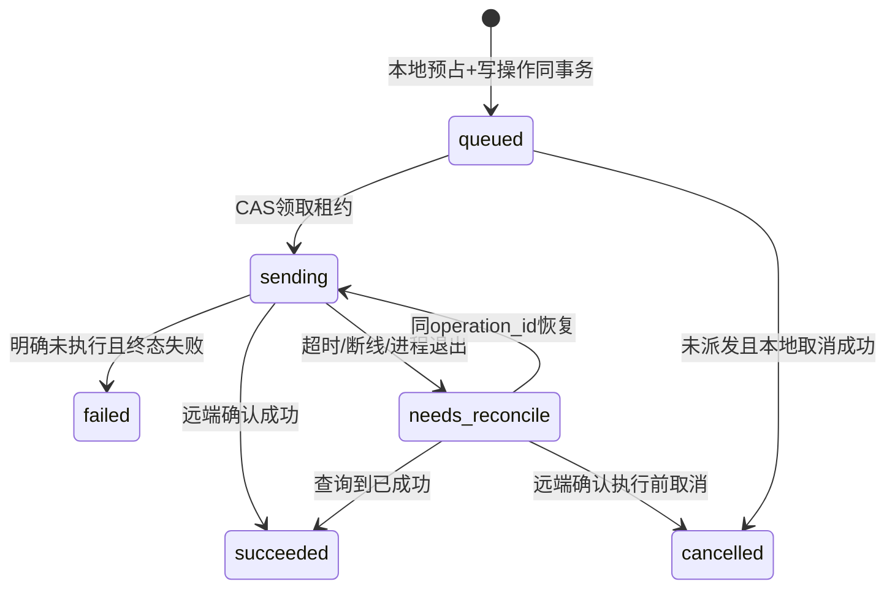

# QQ 查询 Xboard 流量与一次赠送重置详细方案

## 1. 产品边界与现有能力

本功能面向已经在 MoNexus 购买 Xboard 套餐的用户。用户的 MoNexus 注册邮箱与 Xboard 邮箱可以不同，已有购买关联应自动复用。

| 能力 | 当前事实 | 本次处理 |
| --- | --- | --- |
| QQ → 站内用户 | `ChatBinding` 按平台/QQ 及平台/用户分别唯一 | 复用；身份取实际消息发送者 |
| Xboard 邮箱归属 | `FakaProvisionEmailProof` 保存永久或遗留限时证明；已验证站内邮箱也可被信任 | 复用，不让正常老用户再走绑定 |
| 实际开通目标 | `Order.userId → FakaBridgeTask.emailSnapshot` | 按成功履约恢复，不使用注册邮箱猜测 |
| 套餐开通/付费重置 | FakaBridge `order-paid` 支持 `reset_traffic`，进入 Xboard 正常订单生命周期 | 付费沿用，免费独立执行 |
| 流量快照 | 插件已有 `snapshotUserSubscription()`；`order-status.after` 是查询时重新读取 | 复用读取逻辑，新增正式账号查询 API |
| 不可变账号标识 | 现有交付及插件响应没有 Xboard 用户 ID | 新增解析并持久化稳定 ID |
| 免费机会、确认、独立重置任务 | 目前不存在 | 新增权益、意图、操作 outbox 和插件幂等表 |
| 机器人适配器 | 用户确认 AstrBot + NapCat；未定位现用 AstrBot 业务插件源码 | 按 AstrBot 注册命令，使用真实 sender；接口完成不能宣称 QQ 功能已交付 |

代码依据：`modules/chatbot/{service,middleware,routes}.ts`、`modules/fakaBridge/{provisionEmailProof,outbox,worker}.ts`、`lib/fakaBridge/{types,subscriptionResult}.ts`、Prisma schema；PHP 源码位于 `/root/projects/Mo-lab/xboard-plugins/FakaBridge/`。

2026-10-25 实施补充：第三批已完成两端签名、插件只读 capability/订单解析/订阅接口与 MoNexus transport，并在固定镜像的隔离框架夹具中验证。第四批 B1 已实现本地关联、历史回填、默认选择与 QQ v2 查询路由；第五批 B2 已实现一次赠送权益、确认、独立 outbox、插件原生幂等重置及取消/对账（全部默认关闭、未部署）。AstrBot + NapCat 的身份映射、已验证事实与剩余接入门槛见 [签名 v2 与适配契约](./protocol-v2.md)。第十二批已实证线上 Xboard digest/核心摘要与适配基线一致，线上仍为未补丁核心及旧插件；AstrBot/NapCat 为4.27.2/4.7.78，新适配器未安装，详见 [实际部署核对与发布步骤](./production-readiness.md)。

当前实现以 [B2 模块说明](../../../server/src/modules/trafficReset/README.md)、OpenAPI 和实施记录为准：`TRAFFIC_RESET_*` 错误码已落地；实际确认码为 6 位 Base32；取消统一取得远端 tombstone 后释放，不提供仅本地释放路径。第十批起 `freeSuccessfulForAccount`/`paidSuccessfulForAccount` 分别覆盖免费成功和有完整证据的付费 v2 执行，`platformSuccessfulForAccount` 为两者之和，`coverageScope=verified_v2_only`；执行后退款仍计，旧版 v1/站外未覆盖，超过1000条付费任务时 truncated=true、数量为已核实下限。本文后续 DTO/错误表中未同步的部分是原目标设计，不能当作已交付接口。B3a AstrBot 命令、私聊渲染、持久化/重试及丢确认响应恢复已本地实现；B3b1 稳定 ID 付费协议、B3b2 商业任务/worker/退款对账及 B3b3 网站稳定账号结账已完成本地定向验证。网站独立开关 XBOARD_PAID_RESET_TARGET_V2_ENABLED 默认关闭，仅支持 plan-<id>-reset_traffic/reset_price；本人关联选择和目标版本贯穿报价、幂等下单与登录/充值回跳，只免该分支的 Xboard 邮箱 OTP 和新增订阅容量，不免本站邮箱验证、商品权限、价格或库存。B3b4 QQ 购买引用与上述付费计数已本地实现，AstrBot 0.2.0 购买开关独立默认关闭；真实 QQ 灰度及观测指标仍未完成。

## 2. 用户体验

2026-10-26第十三批补充：生产SQLite3.53.4/WAL已只读实证，用户明确选择保留SQLite。插件增加同一文件型main、WAL、同步至少NORMAL及无attached/TEMP遮蔽的执行条件；核心在SQLite先取得数据库写锁再读快照。真实文件多进程/握手竞争、SIGKILL回滚及MySQL受影响回归已通过，新核心摘要/镜像以实施记录第十三批为准。未部署，不能沿用第十一批旧产物直接开放。

建议命令使用现有机器人命令体系注册别名，避免与已有指令冲突；以下仅为拟定展示。

| 用户动作 | 机器人行为 |
| --- | --- |
| `我的套餐` / `查流量` | 解析 QQ 绑定，自动读取已有 Xboard 关联；一个账号直接展示，多个账号提示选择 |
| `我的账号` | 显示本人账号的脱敏邮箱、套餐、状态和默认标记 |
| `切换套餐账号 2` | 校验该账号属于当前站内用户，更新默认选择 |
| `重置次数` | 显示可用免费机会、处理中机会、本平台成功重置次数 |
| `重置流量` | 查询当前套餐与资格，创建有效期 2 分钟的确认意图，不立即重置 |
| `确认重置 <短确认码>` | 一次确认创建一个操作，返回“正在重置”；重复确认返回同一操作 |
| `重置进度` | 返回处理中、成功、失败或正在核对，避免用户重复发起 |
| `购买重置` | 返回当前套餐对应重置商品的站内购买链接；不直接扣积分 |

示例查询响应：

```text
当前账号：ab***@example.com
套餐：标准套餐
剩余流量：35.20 / 100.00 GiB
到期时间：2026-11-20 18:00
免费重置：可用 1 次，处理中 0 次
本平台成功重置：0 次
流量查询时间：2026-10-25 14:00
```

示例确认提示：

```text
将重置 ab***@example.com 当前套餐的已用流量。
本次消耗 1 次赠送机会，套餐总流量及到期时间保持不变。
请在 2 分钟内发送：确认重置 ABC2D7
```

群聊默认只返回脱敏摘要；完整邮箱、详细流量和确认提示优先私聊。若 QQ 平台不支持向该用户主动私聊，提示用户主动进入私聊，不在群里索取验证码或公开完整账号信息。适配器只回复发起用户，不遍历成员主动发送。

## 3. 账号关联恢复

### 3.1 分开三个问题

- **关联事实**：历史上该站内用户为哪个 Xboard 账号成功开通过服务，以及是否有可信归属记录。
- **赠送资格**：是否存在符合活动规则、未退款的成功基础套餐购买；是否已经领取/消费终身一次机会。
- **当前可操作状态**：Xboard 当前账号、套餐、有效期、封禁状态是否允许这次查询或重置。

历史订单到期不等于关联消失；有一张退款单也不等于账号关联必然消失。反过来，仅存在订单或 pending task，不等于已经成功开通。

### 3.2 正常老用户自动恢复

1. QQ 从既有绑定解析 `userId`，查询该用户的成功 Faka 任务与订单记录，按 `lower(emailSnapshot)` 分组。
2. 检查已有邮箱归属证明/可信状态。当前正常下单会校验该邮箱归属；不要求用户再提交已经验证的邮箱。
3. MoNexus 服务端向插件发送本人历史 `external_order_no`，由插件读取 `faka_orders.xboard_trade_no → Xboard Order.user_id → User.id`。
4. **优先使用历史 Xboard 订单的 user_id，而非把旧邮箱重新当成当前账号身份**。这样邮箱后来变更时仍能定位原用户，也避免旧邮箱被新账号使用时关联错人。
5. 插件返回远端用户 ID、当前邮箱、套餐状态和查询时间；本地 upsert 关联，保存历史来源和远端稳定 ID。
6. 多张订单映射到同一远端 ID 时合并成一个账号。多个不同远端 ID 均属于本人时保留多账号，仅一个有效账号时自动选中，多个有效账号且无既有有效偏好时要求显式选择，后续回填不覆盖用户选择。

订单解析服务只能由 MoNexus 后端持有的桥接密钥调用；机器人不能传任意用户 ID 或任意邮箱查号。远端订单不存在、核心订单被清理或历史不完整时，不凭邮箱字符串强行建立稳定关联。

### 3.3 历史异常处理

历史预检输出以下有限分类：正常可恢复、缺远端订单、缺可信归属证明、同远端账号关联多个站内用户、仅失败/待处理任务、取消/退款/争议、账号不存在。

- 正常记录自动回填，整个功能不新增“所有人重新绑定”的步骤。
- 少量老数据若在邮箱验证门槛上线前产生且没有可靠归属证据，进入异常清单；仅这些记录需要补证或人工处理。
- 跨站内用户的同一 Xboard 账号不得自动抢占或以最近订单覆盖归属。V1 一个远端账号只允许一个有效站内归属；冲突期间不开放免费重置。
- 只有成功订单的证据不能无条件证明付款人就是邮箱当前所有者；异常补证不能被“老用户免操作”绕过。
- 已退款/已到期历史账号如已有可靠关联，仍可显示账号当前状态；是否有可重置套餐及赠送资格另行判断。争议中的相关购买暂停用于免费执行资格，查询保持只读可用。

### 3.4 本地模型

新增 `XboardAccountLink`：

| 字段 | 用途 |
| --- | --- |
| `id` UUID | 对用户暴露的本地账号引用，访问始终检查所属用户 |
| `userId` | MoNexus 用户 |
| `instanceId` | 服务端配置的 Xboard 实例标识，不能由客户端传任意 URL |
| `xboardUserId` | 远端稳定标识，按十进制字符串传输，避免整数精度问题 |
| `currentEmail`、`emailSnapshot` | 当前展示邮箱与历史来源邮箱；不当作唯一身份 |
| `sourceOrderId`、`sourceExternalOrderNo` | 关联证据，历史记录不覆盖 |
| `status` | active / blocked / unresolved；不允许静默抢占归属 |
| `resolvedAt`、`lastSyncedAt`、时间戳 | 同步与诊断 |

唯一约束：`(instanceId,xboardUserId)`；查询索引 `(userId,status)`。同一远端账号的归属迁移必须走显式管理流程并保留旧证据。旧关联不因 QQ 解绑删除。

默认账号存于用户偏好 `defaultXboardAccountLinkId`（或独立偏好表）；更新时校验 link 的 userId，不只校验 FK 存在。多账号列表不允许用数据库 ID 绕过所有权判断。

## 4. 一次赠送的业务规则

### 4.1 发放

- 活动稳定码建议 `welcome_traffic_reset_v1`。系统升级、修改文案、QQ 换绑或重新购买均不更换该码来绕开唯一性。
- 每个 MoNexus 用户终身发放 1 次，多个 Xboard 账号共享；同一远端账号也只能享受该活动一次。
- 合格来源是非 `reset_traffic` 的成功基础套餐订单（周期订阅或一次性流量套餐），不是仅创建订单，也不是购买重置包。
- 首版资格要求任务 `succeeded` 且有完成时间、订单 `delivered/closed`、交付记录有效、无取消或撤销；`refunded/disputed` 不作为当次合格来源。
- 发放记录使用唯一约束幂等。新订单在成功交付事务内创建权益，已有用户通过批量回填发放，不在普通查询中隐式领取。
- 原资格单退款时，若另有合格购买可用，则记录新的资格依据；若没有，撤销未使用机会或暂停执行。已消费记录保留，之后再次购买也不重新赠送。
- 账号过期时保留未消费机会，但禁止执行；以后有合格有效套餐可以使用，不因暂时过期反复发放。
- 全部来源变化、退款处理及执行资格复查都必须幂等；后台修正有原因和审计，不删除消费历史。

### 4.2 执行资格

执行前必须同时满足：站内用户正常、QQ 绑定仍属于该用户、关联无冲突、存在合格购买依据、赠送已发放且可用、Xboard 用户存在且未封禁、有有效套餐、套餐属于允许赠送的范围。

到期判断依实际部署版本语义处理 `expired_at`，不把插件展示时的 `0/null` 归一化直接当作权威资格。默认已用流量为 0 时返回“当前无需重置”，不消费机会；重置后立即有少量节点上报属于正常流量变化。

免费重置不要求用户购买新的 Xboard Order，不触发正常订单余额扣除或佣金；是否允许没有配置付费重置价格的套餐享受赠送，由明确的活动套餐白名单控制，而不是依赖价格为零来判断。

### 4.3 权益与确认数据

新增 `TrafficResetBenefitGrant`：`id, userId, benefitCode, granted=1, reserved=0, consumed=0, status, sourceOrderId, revokedReason, createdAt, updatedAt`。

- `UNIQUE(userId,benefitCode)`，用户/来源订单等外键使用保留审计的删除策略。
- CHECK：granted/reserved/consumed 为非负整数，`reserved+consumed<=granted`，本活动 granted 固定为 1。
- 可用数 `status=active ? granted-reserved-consumed : 0`，处理中数为 reserved；不把“预占”显示为“已使用”。
- 发放、预占、成功核销、明确失败释放及撤销均在数据库事务中完成，配套不可重复应用的操作状态 CAS。

新增 `TrafficResetIntent`：`id, userId, chatBindingId, accountLinkId, benefitGrantId, tokenHash, keyId, expectedPlanId, expectedSubscriptionFingerprint, expiresAt, requestId, requestHash, operationId?, createdAt`。

- `UNIQUE(userId,requestId)`；语义 hash 包含活动、实际选定 accountLinkId、QQ 绑定记录及意图类型。同号同语义返回原 intent 和同码，同号异语义 409。默认账号先解析为具体目标；默认选择后来改变时，同号重试仍读取原 intent，不偷偷改目标。过期重放返回原意图已过期，重新发起需新 requestId。
- 确认码绑定用户、账号、QQ 绑定记录和具体意图，有效 120 秒，使用 6 位 Base32 字符，每个意图最多 5 次错误尝试；短码不是全局凭证。
- 为解决“首个响应丢失后同 requestId 重试仍需返回同码”，服务端以专用确认密钥对 `[intentId,userId,chatBindingId,accountLinkId,expiresAt]` 做 HMAC 并截取确认码，持久化散列与 keyId。相同意图可重新派生原码，无需保存明文或重建机会；过期 key 保留到该批 intent 全部过期。该密钥只在 MoNexus 服务端配置，不下发机器人。
- 同用户重复确认同 intent 返回同一 operation；`operation.intentId` 唯一。提交后 intent 过期不取消已经提交的合法操作。
- 默认账号切换不会改变已签发 intent 的目标；目标账号和预期套餐均为快照。QQ 解绑重绑后旧意图失效。

## 5. 独立操作 outbox 与状态机

不能直接复用 `FakaBridgeTask`：它的 `orderId` 必填，成功路径还会交付订单、扣冻结积分。免费重置没有商业订单，需要独立操作表及 worker。

新增 `XboardTrafficResetOperation`：

```text
id UUID (= 跨系统 operation_id，重试不变)
userId / intentId UNIQUE / benefitGrantId / accountLinkId
instanceIdSnapshot / xboardUserIdSnapshot / benefitCodeSnapshot
sourceOrderId / expectedPlanId / expectedSubscriptionFingerprint
requestId / requestHash
status: queued | sending | needs_reconcile | succeeded | failed | cancelled
attempts / nextAttemptAt / leaseUntil / leaseToken
reservationApplied / consumptionApplied
remoteResultRef / completedAt / errorCode
beforeSnapshot / afterSnapshot / createdAt / updatedAt
UNIQUE(userId, requestId)
```

敏感快照只供本人或授权管理端，不进入公共商品 DTO。尝试次数、下次时间和租约有索引；`requestHash` 不包含可更新的签名时间戳或 nonce。



### 5.1 本地事务

创建操作锁顺序统一为：用户/当前 QQ 绑定校验（需要锁时固定顺序）→ 权益行 → intent → 已存在 operation。worker 应用结果按 **权益 → operation** 锁序；所有调用路径保持一致，避免相反顺序死锁。

事务内完成重放检查、资格校验、`reserved+1`、创建 operation 和 intent 关联；提交后调度首次尝试。数据库事务内不发 HTTP。

查询外部状态在事务外，随后事务中重查当前用户及资格版本。涉及来源订单争议/退款变更的路径统一锁序并回归现有 Order 锁规则；如果无法安全与既有退款事务同锁，采用资格版本 CAS/执行前复查，不能临时加反向 Order 锁。

### 5.2 Worker、重试与对账

- 固定 `operation_id`、账号、活动、来源与预期套餐；只有时间戳/nonce/租约随尝试更新。
- worker 使用现有 cron lease 模式，多实例 CAS 领取，租约 token 防过期 worker 回写。
- 默认远端超时 5 秒，首次立即，后续 5 秒/30 秒恢复；达到自动次数上限后转 needs_reconcile，不把未知结果转成失败并退机会。
- 恢复前先查询远端 operation；远端成功，本地事务 `reserved-1, consumed+1` 并 CAS succeeded，重复应用不再扣次。
- 明确未执行终态失败或远端执行前取消，`reserved-1`，保持 consumed 不变。
- 本地 HTTP 超时、5xx、状态 not_found 均不能单独证明没有执行；机会继续预占，页面显示“正在核对”。
- 对发送过的未知操作，若需放弃，必须调用远端执行前取消接口，取得终态 tombstone 后才能释放。不能只因查询 404 就释放，原请求仍可能晚到。
- outbox 扫描可恢复进程在“远端成功、本地未落账”之间崩溃的操作；不依赖首次 fire-and-forget 一定运行。

## 6. Xboard 插件扩展

本地插件实际链路是 `order-paid → handleOrder → fulfill → OrderService::createFromRequest → paid/open`。免费操作另增 v2 路由，现有付费 API 保持兼容。

| 拟新增插件接口，均使用 POST + JSON | 目的 |
| --- | --- |
| `/plugin/faka-bridge/v2/capabilities` | 返回协议能力、插件构建标识和可用核心适配能力 |
| `/plugin/faka-bridge/v2/user-resolve` | 通过历史外部订单解析真实远端 user_id |
| `/plugin/faka-bridge/v2/user-subscription` | 按服务端已解析的远端 ID 查询当前套餐和流量 |
| `/plugin/faka-bridge/v2/traffic-reset` | 执行受授权的免费 reset operation |
| `/plugin/faka-bridge/v2/traffic-reset-status` | 读取操作持久状态和执行结果 |
| `/plugin/faka-bridge/v2/traffic-reset-cancel` | 原子记录执行前取消；已成功则返回成功结果，不伪造撤回 |
| `/plugin/faka-bridge/v2/order-paid` | 付费 reset 按已关联稳定用户 ID 履约，沿用商业订单生命周期 |

### 6.1 远端幂等存储

新增 `faka_traffic_reset_operations`：`client_id, operation_id UNIQUE(作用域client), payload_hash, actor_ref, xboard_user_id, benefit_code, status, expected_plan_id, before_json, after_json, completed_at, error_code, timestamps`。

新增活动消费标记表，至少有两个唯一约束：`(client_id,benefit_code,actor_ref)` 和 `(client_id,benefit_code,xboard_user_id)`。它只记录成功消费，不负责向用户发放次数；分别防同一站内用户跨 Xboard 账号重复，以及同一远端账号跨站内身份重复。

`client_id` 由服务端密钥配置映射，不信任调用方自行声明新的 client 来绕过限额。`actor_ref` 是稳定站内用户标识，与 QQ 无关。

### 6.2 执行事务

1. 校验签名、输入、操作号及 payload hash；新操作占坑，已有操作先比对语义指纹，同号异参返回 409。
2. 按固定顺序锁 operation → Xboard User，重读当前订阅，检查未封禁、有效期、允许套餐、预期订阅指纹及活动未消费。
3. 指纹包括 plan_id、transfer_enable、expired_at，并在核心支持时包括最近 reset 标识；不包含持续变化的 u/d，避免正常使用导致无意义冲突。
4. 套餐切换/自动重置发生导致指纹变化，明确拒绝旧意图，要求重新确认，且不消费机会。执行前已用为零时也不消费。
5. 调用部署版本支持的原生流量重置服务，检查返回值；服务返回 false 必须当失败处理，不能记录成功。
6. 同一事务保存 before/after、活动消费标记和 succeeded；外部操作重复返回这次原结果，不再重置。
7. 不创建 Xboard 商业订单，不调用会扣余额/计算佣金的 createFromRequest，不变更 plan_id、套餐总额和 expired_at。

原子边界是硬性契约：流量字段、重置计数/日志、消费标记和 operation 的成功记录，必须在 **同一数据库连接、同一可回滚外层事务** 提交。原生服务内部 transaction 只有在同连接嵌套并服从外层提交时才可复用；不能先提交重置，再单独写幂等成功。缓存清理可重复执行，外发 hook 需放 after-commit 或有幂等处理，不把不可回滚外发成功当成数据库事务的一部分。

如果实际核心服务在别的连接提交、异步重置或不可纳入该事务，必须先由核心提供接收 operation_id 的幂等执行记录及查询，再开放功能；仅有插件操作行无法填补“核心已提交、插件尚未记录”的崩溃窗口。测试须在核心写入后、成功记录提交前注入崩溃，确认整体回滚或由核心幂等记录恢复，不允许第二次清零。

核心服务的日志、计数、缓存清理及 hook 应得到保留。官方 master 当前有 `TrafficResetService::performReset`，但实际部署镜像可能不同，实施必须做核心适配及契约测试，不能假定方法存在或仅手写 `u=d=0`。[官方服务源码](https://github.com/cedar2025/Xboard/blob/master/app/Services/TrafficResetService.php)（本会话核验 2026-10-25；不是线上部署证据）。

还应验证该版本定时重置、付费开通与手工重置是否使用兼容的用户锁和最新模型；仅在新插件加行锁，不足以证明所有核心并发写路径安全。不能在没有并发证据时宣称跨所有来源严格单次。

### 6.3 超时与取消 tombstone

cancel 使用同一 operation ID。若操作尚不存在，原子插入 cancelled 记录；若执行中，按同一行锁等待裁决；已 succeeded 则返回真实结果。原始执行请求晚到时会读到 cancelled，拒绝执行。

取消不可逆转已经执行的重置，也不调用现有 `order-revoke` 去过期用户。执行资格失败需保存可查询的未执行终态，不能只抛 HTTP 错误让调用方猜测。

### 6.4 部署与版本

统一 `config.json` 与 `Plugin::VERSION`，增加协议能力而不是只比较版本字符串。免费 write gate 至少确认 `resolve_by_order`、`subscription_by_user_id`、`reset_idempotency`、`reset_status`、`cancel_tombstone`；按稳定 ID 的付费 reset 另要求 `paid_reset_by_user_id`。

新增 Laravel migration 使用插件实际支持的加载方式；当前 Provider 代码不能证明迁移会自动发现。必须在与部署一致的隔离 Xboard 环境验证安装/升级命令、事务表引擎及索引。web/Octane 和 horizon 都加载同一插件版本后再开放写操作。

## 7. MoNexus 与机器人 API

拟新增 `POST /api/bot/v2/xboard/*`，请求均携带实际发送者的 `platform/platformId`，由后端反查 `ChatBinding`，不接受客户端 `userId`、任意邮箱或远端 URL。

| 路径后缀 | 主要请求字段（另含平台身份） | 响应重点 |
| --- | --- | --- |
| `accounts` | 无 | 本人账号列表、默认账号、关联/同步状态 |
| `profile` | `accountLinkId?` | 套餐、流量、当前可操作状态、免费机会、次数与查询时间 |
| `select-default` | `accountLinkId, requestId` | 默认账号；同请求重放一致 |
| `reset-intents` | `accountLinkId?, requestId` | 确认码、有效期、明确的目标与消耗提示 |
| `resets` | `intentId, confirmationCode, requestId` | 首次 202 operation；重放返回同一资源，不重复预占 |
| `reset-status` | `operationId` | 本人操作状态、成功快照或脱敏失败原因 |
| `reset-purchase` | `accountLinkId?` | 本套餐可购买重置商品 URL/当前提示价格，正式报价由网站重算 |

Web 若需要共享查询功能，可增加 JWT 适配器并调用同一业务服务；不要复制免费次数或账号解析逻辑。V1 不要求为此重做个人中心。

### 7.1 查询 DTO

```ts
type XboardProfile = {
  account: { id: string; maskedEmail: string; isDefault: boolean }
  subscription: {
    status: 'active' | 'expired' | 'no_plan' | 'blocked'
    planId: string | null
    planName: string | null
    totalBytes: string
    uploadBytes: string
    downloadBytes: string
    usedBytes: string
    remainingBytes: string
    expiresAt: string | null
    nextResetAt: string | null
  } | null
  freeReset: { granted: number; available: number; reserved: number; consumed: number }
  resetHistory: {
    platformSuccessfulForAccount: number
    xboardAllSources: number | null
    coverageFrom: string | null
  }
  freshness: { queriedAt: string | null; stale: boolean; unavailable: boolean }
  canFreeReset: boolean
  blockReason: string | null
}
```

字节和远端 ID 使用十进制字符串跨系统传输；节点已用超过总额时 remaining 下限为零。总额取 User.transfer_enable，不能拿 Plan 中可能为 GiB 的字段不经换算直接减 u+d。到期、无套餐与流量耗尽分别显示。

### 7.2 错误契约

| 场景 | HTTP / 业务码 | 处理 |
| --- | --- | --- |
| QQ 未绑定 | 200，`bound=false` | 引导使用已有站内绑定流程，不误称需要重绑 Xboard |
| 多账号未选择 | 409 `XBOARD_ACCOUNT_SELECTION_REQUIRED` | 返回本人脱敏选项，不任意猜目标 |
| 他人/不存在账号或操作 | 404 `NOT_FOUND` | 不泄露资源存在性 |
| 历史关联异常 | 409 `XBOARD_ACCOUNT_UNRESOLVED` | 引导核验具体异常，不要求全部老用户重绑 |
| 无可用机会 | 409 `RESET_BENEFIT_UNAVAILABLE` | 如有处理中操作先显示进度，否则给购买入口 |
| 意图过期/确认错误/绑定变更 | 409 `RESET_INTENT_EXPIRED` / 400 `RESET_CONFIRMATION_INVALID` / 409 `RESET_BINDING_CHANGED` | 不预占，不执行；用户重新发起 |
| 套餐或重置周期改变 | 409 `RESET_SUBSCRIPTION_CHANGED` | 重新查询并确认，不沿用旧意图 |
| 已用为零 | 409 `RESET_NOT_NEEDED` | 不消耗机会 |
| 幂等号异参 | 409 `IDEMPOTENCY_KEY_REUSED` | 禁止复用该号创建新目标 |
| 插件能力不满足 | 503 `XBOARD_CAPABILITY_UNAVAILABLE` | 禁止写操作，不回落旧免费订单路径 |
| 查询远端失败 | 有本地资料时 200 并标 unavailable/stale；完全不可用时 503 | 不伪造流量值，不改变次数 |
| 超时结果未知 | operation 保持 `needs_reconcile` | 202/200 返回操作状态，不把未知结果当明确失败 |

错误码供适配器映射自然语言，默认回复不堆叠内部码、payload 或完整远端错误。

### 7.3 查询缓存

按 instanceId + xboardUserId 缓存 15 秒当前快照并合并同目标在途请求；授权在读取缓存前独立校验，缓存不混入用户权益。权益和操作次数从本地读取。

远端短时失败可返回不超过 60 秒的旧快照并标 stale/原查询时间；无旧数据则 subscription=null、unavailable=true，保留本地次数。写操作资格不使用这份缓存，执行成功立即失效该账号缓存。

默认每用户查询限 10 次/分钟，意图 3 次/分钟，确认有独立错误次数限制；机器人查询进度采用有限退避，停止后用户可主动再查。限流按用户/QQ及操作维度，不仅按机器人主机 IP。

## 8. 签名 v2 与权限

现有 bot 签名只覆盖 body 字段、timestamp 和相对路由路径，不覆盖 HTTP method 或幂等请求头，且 flat string 拼接不适合扩展复杂 DTO。新增写接口使用独立版本，旧绑定/签到接口保持兼容。

两条链路分别使用现有 bot secret 和桥接 secret，绝不把 Xboard 管理密钥下发 QQ 适配器。新签名建议：

```text
rawBodyHash = SHA256(实际发送的UTF-8 JSON字节)
payload = JSON.stringify([
  "monexus-hmac-v2", audience, METHOD, canonicalFullPath,
  timestampMs, nonce, rawBodyHash
])
signature = HMAC_SHA256(secret, payload)
```

- audience 明确为 bot 或 xboard，跨链路、跨方法、跨路径不能挪用；fullPath 定义为外部协议完整路径，不混用 Express mount 后的 req.path。
- 新 v2 接口统一 POST、无 query 参数，避免 query 规范化分歧；时间窗默认 ±5 分钟，nonce 为至少 128 bit 随机值。
- 服务端保留原始 body bytes 验签，再严格 DTO 校验。接入 raw body 捕获时保留现有支付 webhook 的 mount/解析顺序，不破坏支付验签。
- Redis nonce 去重仅防同一网络包重放；合法重试使用新 nonce，但保持相同 requestId/operationId。业务唯一性由数据库负责，不能只依赖 nonce。
- requestId 放在签名 body 内；同用户同 ID 同语义返回原操作，异语义 409。语义 hash 排除签名时间、nonce 和确认码等非业务字段，并固定规范化数组测试向量。
- 新写接口拒绝 v1 回落。密钥轮换可有受控 keyId 窗口，所有比较使用常量时间函数。
- QQ 来源必须取平台事件真实 sender，禁止从用户命令文本指定 platformId；后端信任边界仍是持密钥的适配器。
- 检查用户当前状态与绑定记录，未知/他人账号及 operation 返回 404；私有数据不因持机器人密钥就开放按任意邮箱搜索。

## 9. 重置次数的口径

| 显示项 | 数据来源 | 明确含义 |
| --- | --- | --- |
| 可用免费机会 | active grant 的 granted-reserved-consumed | 当前还可以免费使用几次 |
| 处理中机会 | grant.reserved | 已提交但未核实完成，不可再次消费 |
| 本平台成功重置 | 当前选定账号的新免费 succeeded operations + 已证实成功的旧/新付费 reset tasks | 按稳定远端账号归并，只统计可追溯的实际执行，不代表全站全部来源 |
| Xboard 全来源重置 | 部署版本确有字段/日志时由插件返回，否则 null | 可能包含自动周期、新购等，不能当成购买次数 |

付费历史按规范化 `periodSnapshot=reset_traffic`、成功任务及远端执行证据归类，不靠商品中文名或当前 SKU 名称猜测。同一外部请求不能因对账或回填重复计数。

退款不会逆转实际已经发生的流量重置，所以历史“成功执行次数”不因退款自动减一；赠送资格、可用次数与历史执行次数分别计算。历史缺少证据时显示统计覆盖范围，不伪造完整的终身总次数。

免费机会按 MoNexus 用户共享，历史次数按当前选定 Xboard 账号显示。若未来增加“所有账号累计”，另加独立字段，不能让切换账号时同一字段的统计范围漂移。

## 10. 后续付费重置与现有流程的兼容

购买链接由服务端根据当前远端 plan_id 匹配 active 的 reset_traffic Offer；不能把月付/onetime 商品误当重置包。若没有匹配商品，返回“当前套餐暂未配置重置购买入口”，不得引导买错误套餐。

网站选中正确 Offer 与本人 accountLinkId；仍走 expectedPrice/checkoutVersion、幂等、积分、订单和 Faka 商业履约。机器人展示价格仅为提示，网站正式报价为准。

这里不能仅“预填当前远端邮箱后照用原 OTP 校验”：原证明可能是旧邮箱，远端改邮箱后即使已通过历史订单恢复稳定身份，新邮箱也未必在原证明表中。

为 reset 购买新增受控目标分支：

1. checkout/订单 schema 接受 `xboardAccountLinkId`，仅当服务端确定 Offer 为 reset_traffic 时使用。后端校验归属和可信历史来源，查询稳定远端 ID 的当前订阅，再检查目标套餐匹配。
2. 此分支的信任锚是已验证关联与稳定 ID，不要求重复证明后来变化的邮箱，也不把新邮箱未经验证地写成全局 OTP 证明。新订阅/任意邮箱下单仍使用原邮箱校验。
3. 给商业订单 task 增加 nullable 的 `instanceIdSnapshot`、`xboardUserIdSnapshot` 和协议版本快照；新的已关联 reset 任务固定这些字段及当前展示邮箱。订单幂等指纹包含关联账号和稳定目标，preview 与创建使用同一服务。
4. worker 对这类 reset 使用 v2 order-paid：插件按稳定 User.id 查现存用户、核实当前 plan，绝不按邮箱 findOrCreate；邮箱只作为快照展示。核心商业订单、正常支付及佣金规则保持原语义。
5. v2 商业重试在既有 external_order_no 唯一基础上持久化并校验目标 ID、SKU、period 的语义 hash；任务协议版本不可因重试动态切换。同号异参拒绝，不能重定向已占坑订单。
6. 存量 v1 pending/processing 任务先沿既有单号对账，不在未知结果时换协议或换目标。新分支尚未就绪时，禁止宣称邮箱已变更的账号也具备付费闭环。

**需要补一项现有规则核验/修复**：`orders/service.ts` 当前对所有 Faka Offer 统一以 plan capacity 的 sellable 阻止购买，checkout preview 也有对应判断；该 capacity 表达新订阅人数名额。重置已有账号不增加订阅人数，不能简单因满额而禁止。

实施时以服务端规范化的 reset_traffic 操作和远端当前用户/套餐事实作专用预检；只跳过“不新增订阅人数”这一不适用的名额门槛，继续校验身份、当前套餐、有效期、重置售卖规则、金额及库存。preview、订单创建和插件侧保持一致；新购资格不得因此放宽。

该改动属于关键购买旅程，需覆盖满额套餐的正常重置、错误账号/套餐拒绝、新购仍受名额限制及原有支付履约回归，不能仅增加一个购买链接就宣布后续付费闭环完成。

## 11. 历史回填与上线步骤

### 11.1 配置

拟新增配置统一经 `server/src/config/index.ts` 解析，并同步根目录及 server 的环境示例。实例配置使用已有桥接目标加稳定 instanceId，不接受用户输入的 base URL。

| 建议配置名 | 初始值/用途 |
| --- | --- |
| `XBOARD_ACCOUNT_QUERY_ENABLED` | false，查询链路完成后单独开启 |
| `TRAFFIC_RESET_GRANT_ENABLED` | false，控制新订单及回填新增发放，不撤销已有权益 |
| `TRAFFIC_RESET_REQUESTS_ENABLED` | false，控制接受新的免费确认操作 |
| `TRAFFIC_RESET_DISPATCH_ENABLED` | false，控制新的远端执行派发；既有未知结果继续只读对账 |
| `XBOARD_PAID_RESET_TARGET_V2_ENABLED` | false，稳定 ID 付费分支与插件能力共同就绪后开启 |
| `TRAFFIC_RESET_CONFIRM_SECRET` | 服务端专用随机密钥，缺失时不创建确认意图；附 keyId 支持短期轮换 |

时间窗、意图 TTL、限流、查询缓存及 worker 并发使用有边界的配置；所有启用条件、默认值和失败行为写入配置测试。管理只读查询可用性与执行开关分离，关掉执行后仍能解释已有操作状态。

### 11.2 上线顺序

1. 隔离环境对齐实际核心/插件版本和迁移机制，修复版本常量，部署查询/解析/幂等接口；写开关关闭。
2. MoNexus 增量迁移账号、权益、intent、operation；商业 task 仅增加可空的稳定目标/协议快照，保持旧任务可读和原订单关联。
3. 执行只读预检脚本，输出候选用户数、邮箱去重数、来源状态分布、归属证明覆盖和远端缺失/冲突数。日志不输出完整邮箱/QQ。
4. 提供 `dry-run` 默认模式、按 userId 游标批处理、checkpoint、cron lease、并发上限和可重复执行脚本。正常关联自动解析，无需用户交互。
5. 关联恢复与赠送发放分开统计；每人可产生多个账号关联，但只 upsert 一份 grant。未决异常不自动发放可执行机会。
6. 新交付事务接入发放，避免回填扫描期间漏掉新用户；唯一约束解决扫描与实时发放竞态。
7. 部署机器人适配器查询与确认交互，先允许内部账号读，再灰度免费执行；验证真实私聊/群聊平台限制。
8. 开放后持续对账已有 operations，观察冲突、未知结果、错误及余额不变量，再逐步扩大。

关闭新赠送发放不撤回已发放权益；关闭新执行不停止已提交操作的对账。若需暂停外部派发，区分“从未派发可本地取消”和“可能已派发必须远端核对/取消”。

## 12. 测试、监控与交付标准

### 12.1 必须通过的核心场景

| 场景 | 预期 |
| --- | --- |
| 注册邮箱 A、下单 Xboard 邮箱 B | 自动定位 B；不要求重新绑定，不查询 A 代替 |
| 多次购买同一远端账号 | 一个关联、一份赠送；订单全部可追溯 |
| 多个不同 Xboard 账号 | 共享一次机会；选择和确认目标不漂移 |
| 旧邮箱已变更 | 通过历史 Xboard Order.user_id 定位原账号，不把旧邮箱新使用者当本人 |
| 旧邮箱已变更后付费 reset | 本人关联与稳定 ID 授权成功，无需再证明新邮箱；新购任意邮箱仍受原校验 |
| pending/失败/撤销/退款/争议订单 | 不因仅有任务就发放；关联与资格按各自规则处理 |
| 回填与新交付同时发生 | 唯一发放，不遗漏正常新购买 |
| 同用户并发 50 次确认/重复 request | 只预占一次、创建一个有效消费操作、远端只重置一次 |
| 同号异参、跨用户 intent/operation | 409 或 404，零副作用 |
| 解绑重绑/切换默认账号 | 旧 intent 不可借用，已消费机会不恢复 |
| 远端成功但响应丢失/本地崩溃 | 继续预占；对账核销一次，不重新生成操作号 |
| 核心已写入、插件成功记录未提交时崩溃 | 同事务回滚，或由核心 operation_id 记录恢复，不二次清零 |
| 状态查询 not_found，原请求晚到 | 不直接释放；cancel tombstone 能挡住迟到执行 |
| 远端取消与执行并发 | 同 operation 锁裁决，返回真实成功或未执行取消，无假退款 |
| 套餐切换/到期/封禁/自动重置发生 | 重新校验，旧意图拒绝且未执行不消费 |
| 免费执行 | 无 Xboard 商业订单、无余额扣款/佣金；plan/总流量/到期不变，日志及缓存正确 |
| 免费用完购买重置 | 正确商品、正确账号、正常积分支付；满额不错误阻止重置，新购仍受限 |
| 流量服务故障/节点延迟 | 不显示零余额；标记缓存时间，不据旧快照执行 |
| 群聊/私聊权限 | 不公开完整账号信息，不响应伪造 sender |

### 12.2 分层验证

- MoNexus 服务端：真实可丢弃 PostgreSQL 验证唯一约束、锁、预占、回填、退款、身份与计数；远端 transport 用可控桩模拟超时、迟到、冲突和丢响应。
- 插件：Laravel 契约与事务测试覆盖真实核心 adapter、唯一索引、并发执行/取消、原生服务 false 返回、无误创建账号。
- QQ 适配器：验签测试向量、真实 sender、命令上下文、确认过期、重试相同 requestId、脱敏渲染。
- 集成验收：隔离 Xboard + MoNexus 的同一测试账号，从历史关联恢复到重置成功及再次查询；不对生产用户运行破坏流量的验证。
- 付费入口按现有关键购买旅程回归；错误和并发大部分放服务端测试，不为每个错误额外增加浏览器 E2E。

### 12.3 观测

低基数指标：查询成功/失败与延迟、cache hit、关联解析结果、grant 发放/冲突、operation 状态转换、needs_reconcile 数量/最老等待时长、租约恢复、远端幂等重放/冲突及取消结果。指标标签不带邮箱、QQ、userId、operationId；关联 ID 仅进入受控日志和管理详情。

提供最小管理查询与受保护的对账/取消命令，能定位“谁的哪次操作卡住、远端是否执行、权益是否仍预占”。手工修正必须记录理由，不提供无审计的“次数+1”按钮。

### 12.4 文件交付范围

| 层 | 主要改动 |
| --- | --- |
| MoNexus 模型 | Prisma schema 与增量 migration；用户、订单审计关系 |
| 账号及权益业务 | 建议新 `modules/xboardAccounts/`、`modules/trafficReset/`；不扩成单一巨型 service |
| 协议基础设施 | `lib/fakaBridge` 新 transport/type/signature v2；不反向导入业务模块 |
| QQ HTTP 适配 | chatbot 新 v2 routes/controller/schema/signature；复用用户解析 |
| 交付/退款衔接 | 新资格单发放、资格失效处理，不修改原积分结算含义 |
| Worker/脚本 | reset outbox、cron lease、对账/取消、dry-run 历史扫描及回填 |
| 插件 | 新 v2 routes/controller/service/models/migrations；核心 adapter 与 capability |
| 机器人 | 实际适配器新增查询、选择、确认、进度、购买链接；位置需落实 |
| 文档与契约 | OpenAPI、跨项目桥接契约、配置示例、运维与回滚说明 |

交付完成必须包含两端与真实 QQ 会话验收。仅完成某一侧 API、仅看到本地 succeeded 或仅配置版本升级，均不代表赠送重置闭环已经可用。
