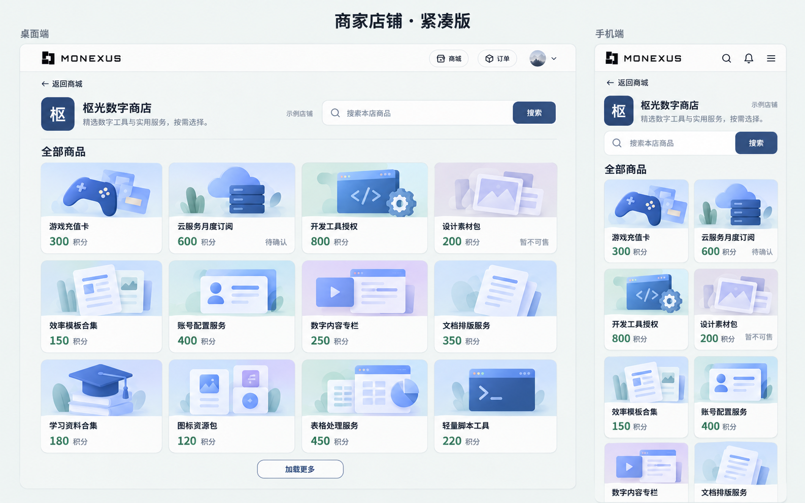

# 商家公开店铺页实施方案

| 项目 | 内容 |
| --- | --- |
| 文档 ID | `PLAN-MERCHANT-STOREFRONT-001` |
| 版本 | `1.3.0`（业务契约定稿；全部代码实施交由接手 agent） |
| 日期 | 2026-10-15 |
| 状态 | 已在 `feat/merchant-storefront` 本地实施并完成定向验证（§10）；待代码 review，未推送或建 PR |
| 核验基线 | `origin/develop@ee82f3aed566ca8d0ae34341a6f1d43806243c5c`，2026-10-15 重新 fetch 后确认，已包含 #250–#255 |
| 实施基线 | 开工时重新 fetch 的最新 `origin/develop`；记录实际完整 SHA，若有推进则核对相关锚点，不能从方案分支或旧本地 develop 创建功能分支 |
| 分支 | 方案：`chore/merchant-storefront-plan`；拟实施：`feat/merchant-storefront`，PR base：`develop`，详见 §9 |
| 目标 | 买家从商品详情“进入店铺”，浏览同一商家的其他商品 |
| 关联 | [商品模型](product-model-and-checkout.md)、[商品与交易规格 §6](product-commerce-v2/spec.md)、[可售状态方案](public-product-availability-and-recommendation-quality.plan.md) |
| 工程规范 | [分支与 CI](../branching-and-ci.md)、[测试政策](../testing-policy.md) |

## 1. 产品目标与首版范围

新增商家面向买家的公开商品集合页，形成“商品详情 → 进入店铺 → 搜索或浏览商品 → 另一件商品详情”的路径。

例如：商家 A 同时经营 Steam 充值卡、订阅开通和人工服务。买家查看 A 的充值卡时，相关推荐仍按现有相关性规则选最多 6 件；点击“进入店铺”则查看 A 所有对当前身份可见的上架商品，包含不同分类，支持搜索和分页。商家 B 的商品不会出现在 A 的店内，即使 A 只有一件商品也不跨店补齐。

本轮仅交付方案，全部代码实施交由另一个接手 agent，范围包括后端、前端设计与实现、数据库迁移、测试及运行验收。本方案确定功能范围、接口、数据与权限语义、Git 基线和验收目标；代码锚点、模块划分与文件落点用于指导实施，普通实现取舍由接手 agent 结合最新项目决定。

前端应结合当前项目的组件、主题和真实内容设计；具体列数、断点、尺寸、组件拆分和展示细节不在本方案冻结，§12 图片仅作可选参考。

首版业务范围如下：

| 能力 | 首版决定 |
| --- | --- |
| 地址 | `/shops/:merchantId`，使用真实商家正整数 ID |
| 访问 | 游客可进店；会员商品继续只对有效登录用户可见 |
| 店头 | 真实商家名称和公开简介；头像等辅助展示按现有能力设计 |
| 商品 | 复用公开卡片数据与已有展示能力；每页最多 24 件，支持继续加载 |
| 设计 | 浏览商品优先，信息密度适当；实施 agent 自主决定响应式布局和组件实现 |
| 搜索 | 只搜索当前商家，URL 使用 `?q=`；触发方式按现有交互习惯设计 |
| 排序 | 沿用商城自然列表的经营排序，无新增排序选项 |
| 入口 | 商品详情桌面、平板、手机均有真实链接；正常商家的后台增加“查看店铺” |
| 平台自营 | `merchantId=null` 没有本轮店铺页，保持“平台自营”，不构造 `/shops/0` |
| 可售状态 | 保留 `available / unavailable / unknown` 三态；不可售商品仍可浏览 |

不纳入：店铺装修、封面上传、自定义域名或 slug、关注收藏、店铺评分与销量汇总、店内分类管理、商家目录、客服聊天、店铺短链、新曝光点击统计。

这项功能独立于推荐路线的 PR3/PR4；不改变推荐匹配、同店优先、候选上限或归因规则。

## 2. 已核对的现状与复用边界

目前 `/merchant/*` 是经营后台，公开商品列表没有商家筛选，详情页“进入店铺 / 逛逛店铺”仅在参考预览中打开静态弹窗，不能直接当作真实店铺启用。

| 代码 | 现状与本轮用法 |
| --- | --- |
| `server/src/modules/products/service.ts` | `listProducts()` 已有排序、游标、Redis 缓存、实时可见性过滤、经营身份和保障装饰；增加内部商家范围并复用整条列表管线 |
| 同文件 `hydratePublicListItems()` | 已统一商品卡片和商品级可售状态；继续通过列表管线调用，不复制补全逻辑 |
| `server/src/modules/products/cache.ts` | 缓存尚无商家维度；需要补齐 |
| `server/src/modules/merchandising/publicProjection.ts` | 游标绑定排序 run 和筛选 hash；复用格式与错误码 |
| `server/src/modules/products/visibility.ts` | 继续统一商品生命周期、商家有效性和 guest/member 规则 |
| `server/prisma/schema.prisma` | `Merchant` 已有名称、简介、状态；`Product.merchantId` 有外键但没有索引 |
| `src/components/store/StoreProductCard.tsx` | 支持 `href` 原生链接和现有三态展示，可优先复用；是否扩展展示变体或使用轻量封装由实施 agent 决定，不能改变其他入口的既有行为 |
| `src/pages/StorePage.tsx` | 列表还包含全站推广/精选混排、虚拟网格与商城恢复逻辑；不把整页抽成通用框架 |
| `src/pages/storePageCache.ts`、`src/components/ScrollToTop.tsx` | 商城缓存和恢复标记不含商家；浏览器使用手动滚动恢复，本轮不借用这些状态 |
| `src/api/client.ts`、`src/auth/sessionContext.ts` | 复用认证请求、刷新和会话隔离；不新增认证机制 |

新增一个轻量店铺页面、一个公开店铺接口。商品筛选、序列化、缓存失效和可售判断保留一个来源。

## 3. 公开接口契约

### 3.1 路径和参数

```http
GET /api/shops/:merchantId/products?q=Steam&cursor=...
```

- `merchantId`：正整数，使用现有 Zod 参数校验约定。
- `q`：可选字符串，trim 后最多 50 字符；空串视为未搜索，允许单字符。匹配和归一化复用商品列表，匹配名称、简介、旧类型与分类名称，不新增模糊语义搜索。
- `cursor`：可选，使用现有商品列表游标。
- 页大小服务端固定 24。不接收 `limit/page/pageSize/category/sort` 作为功能参数，不扩展全站 `/api/products` 的公开查询契约。

### 3.2 响应

```ts
type ShopProductsResponse = {
  shop: {
    id: number
    name: string
    description: string | null
  }
  items: Product[]           // 与商城公开卡片 DTO 一致
  nextCursor: string | null
  hasMore: boolean
}
```

`shop` 与首屏商品一次返回，空店也有店头信息，不新增单独的 profile 接口。`Product` 使用现有公开字段；不新增店铺商品 DTO 的另一套库存或价格字段。

不返回全店总数、隐藏商品数、可售商品数、经营者审核信息。不得把列表服务内部的 `hasUnknownFakaCapacity` 等缓存提示带出接口。

### 3.3 权限、错误与 HTTP 缓存

路由按顺序使用：设置 `Cache-Control: private, no-store` → `authenticateIfPresent` → `requireActiveUserIfPresent` → 参数校验 → controller。

controller 必须显式用 `resolveProductAudience(req.user)` 传入列表服务，不能依赖内部调用的默认分支。携带失效身份时沿用现有认证处理，不自动降级成游客。

| 情形 | 返回 / 页面行为 |
| --- | --- |
| 商家 active，当前身份没有可见商品 | 200，`items=[]`；显示店头和通用空态 |
| 商家不存在或 pending/suspended/rejected | 同一 404 `NOT_FOUND`，复用 `notFound('店铺暂不可用')` |
| 参数不合法 | 400，沿用 `VALIDATION_ERROR` |
| 游标无效 | 400 `PRODUCT_CURSOR_INVALID` |
| 游标与店铺、搜索、身份或有效 run 不匹配 | 沿用 409 `PRODUCT_CURSOR_EXPIRED` |
| 数据库或网络故障 | 正常错误处理；前端提供重试，不伪装为空店或 404 |

游客看不到会员商品的标题、封面、积分价或计数。空态不解释“有多少商品需要登录”。

## 4. 服务端实现

### 4.1 新增公开 shops 模块

建议按现有模块结构新增 `server/src/modules/shops/{routes,controller,schema,service}.ts`，在 `server/src/app.ts` 挂载 `/api/shops`；文件拆分和内部函数命名由实施 agent 按实际复杂度决定。不挂到 owner-only 的 `/api/merchant` 路由内，也不复用 `GET /api/merchant/me` 的响应。

`listShopProducts(merchantId, {query, cursor, audience})` 只编排以下步骤：

1. 按 `id + status=active` 查商家，select 仅 `id/name/description`，没有记录就返回上述 404。每次请求读取，不增加店头 Redis 缓存。
2. 调用现有 `listProducts({merchantId, query, cursor, pageSize:24, audience})`。
3. 返回白名单 `shop + items + nextCursor + hasMore`。

商家当前状态检查不能由缓存命中的商品列表代替；其余商品可见性继续走现有列表流程。不新增“发出响应前再查一次商家”的复查阶段或事务锁。

### 4.2 商家范围必须进入三个位置

在 `ProductListParams` 增加内部可选 `merchantId`，仅由店铺 service 固定传入。三个改动缺一不可：

1. **SQL**：`listRankedProductRows()` 在已有条件中增加参数化 `p."merchantId" = merchantId`，位于排序与 `LIMIT` 之前。不能取全站一页再按商家过滤。
2. **游标**：`productFilterHashInput()` 在有商家范围时加入 `merchantId`，生成和验证游标使用同一输入。A 店游标不能用于 B 店或全站，搜索词和 audience 改变也不能沿用。
3. **Redis key**：`ProductListCacheParams` 和归一化结果在有范围时加入 `merchantId`，隔离 A 店、B 店和全站的缓存。

无商家范围时不额外写入 `merchantId:null`，保持全站原有 hash 和缓存参数结构；本轮不改游标格式和公开卡片形状，不必因此整体更换缓存版本。

缓存命中后的现有批量实时可见性检查已经读取 `merchantId`。有店铺范围时，在这次检查里同时要求当前归属仍等于该商家；不再另发一次归属查询。

### 4.3 排序与分页

沿用当前排序：固定 run 的 `isHot DESC → effectiveOrderCount DESC → product.id DESC`；没有有效 run 时沿用原实现的退化排序。

- 第一页和后续页使用同一套 merchandising 游标，不另建 shop cursor。
- `nextCursor` 基于 SQL 扫描的最后一行，`hasMore` 依赖多取的一行，沿用 `pageSize+1`。
- 实时过滤导致某页不足 24 件是允许的，继续按返回游标翻页。不增加循环补满、重新排名或第二套分页。
- 商家没有商品时不拿全站热门、跨店推荐或推广内容填空。
- 不请求全站 sponsored/editorial 候选。卡片既有身份、保障与 merchandising 标签按原公开投影保留。

### 4.4 可售状态与缓存失效

店铺是商品目录，**不使用推荐接口排除 `unavailable` 的规则**：三种状态都可出现在目录，卡片按现有语义显示“暂不可售 / 待确认 / 正常”。进入详情后仍由所选套餐和原下单链路判断能否兑换。

复用 `hydratePublicListItems()`、真实本地库存与 Faka 快照；不直接看 `Offer.stock` 或代表 Plan 重算。不新增同步等待 Xboard 的请求；已有快照模块的后台探测照常运行。

店铺列表沿用 `product-list` 缓存版本和已有写入失效机制。任一有效套餐容量未知时不写本次结果，继续使用当前 `cachePredicate`；不增加店铺专属失效表、队列或缓存层。店头信息不在该缓存内，商家改名/简介后下一次店铺请求可见。

### 4.5 数据结构与索引

不新增 Store/Shop 表，不复制商家名称与简介，不迁移商品归属。

唯一数据库改动：为 `Product` 增加 `@@index([merchantId])`，通过一条新 Prisma migration 创建普通 B-tree 索引。服务端新增以商家为入口的查询，外键本身不会替代此索引；本轮不追加全文索引、复合排序索引或搜索服务。

迁移只建立索引，不回填或修改历史业务数据；在可丢弃测试库执行，不直接在生产机运行。

## 5. 店头信息与商家配置

公开 `Merchant.name` 与现有 `description`。后者原表单即“商家简介 / 介绍一下您的商店”，本轮明确作为店铺公开介绍，不新增第二份简介。

- 公共投影 trim 简介，空白返回 null；最多返回前 500 个 Unicode 字符，超出加省略号。保持数据库原文，不借本功能清洗历史资料。
- 页面以普通文本渲染，可保留换行并换行长词；不按 HTML/Markdown 解析，不自动把文本转成外链。
- 在 `MerchantApplyPage.tsx` 和 `MerchantDashboardPage.tsx` 的简介输入旁注明“将展示在公开店铺页，最多展示前 500 字”。不改现有保存接口、必填性或长度校验。
- 如设计需要头像，可用商家名称首字等现有占位方式，不借用商家所属用户头像。没有持久化店铺 logo/封面，本轮不提供上传。
- 不公开 `userId`、联系人邮箱/电话、抽佣比例、审核人、审核原因或内部权益配置。
- 店头不展示“官方认证”“在线”“4.9 分”“售出 1280 单”等未由真实店铺数据支持的标记。不能复制预览名片的指标和荣誉默认值。
- 真实商品保障仍是商品级授权；商家 active 不等于全店商品有平台保障。

商家后台使用当前已加载的 merchant 信息：仅 active 商家显示原生“查看店铺”链接，目标 `/shops/{id}`。停用商家不提供该入口，直接访问仍由公共 API 返回 404。

本轮不新增客服入口。原详情客服继续走既有能力；不能把平台客服描述成已经实现的商家直聊。

## 6. 前端页面与导航

### 6.1 页面设计职责与交互目标

在 `src/App.tsx` 与 `/product/:id` 同层增加公开 `/shops/:merchantId`，使用现有 `SessionLayout`，放在受保护通配路由之外，不修改 Layout 的认证与刷新逻辑。

店铺页面建议落在 `src/pages/ShopPage.tsx`。实施 agent 负责结合现有主题、导航、卡片和响应式习惯完成前端设计，也可以在本功能范围内采用更合适的组件拆分。无需照搬 §12 图片或逐项确认常规设计决定。

必须达到的结果：

- 买家能明确识别当前商家，浏览其商品，完成店内搜索、继续加载和打开商品详情，并能返回商城。
- 店内搜索与全站搜索在含义和状态上分开。URL q 表示已应用的搜索；变更 q 后从第一页开始，浏览器前后退可还原对应搜索。搜索有可访问名称，最大 50 字与 API 一致；非法 URL 参数不能被悄悄改写成另一条查询。
- 商品名、实际积分价和可售状态易于理解；未知不能画成有货或售罄，不可售商品仍可浏览。真实徽标沿用公开投影，不能为视觉效果造认证、评分或承诺。
- 手机、平板和桌面均可操作，长店名、简介、商品名、积分价和状态不会遮挡、溢出；支持现有主题、键盘、可见焦点与足够的触控区域。
- 密度服务于找商品：让商品尽早进入视野，减少重复信息与无效留白，同时保持文字清楚。不能以缩小所有文字或裁掉关键状态来增加商品数量。
- 页面状态独立，不污染全站 `storeQuery/storeCategory` 或商城恢复缓存。现有 `StoreSearchPanel` 与全局状态绑定，若要复用必须妥善隔离，而非直接接入全站状态。

由实施 agent 自主决定：

- 网格或列表、各屏列数、断点、最大宽度、图片比例、留白、字号、店头与搜索位置。
- 商家占位头像、卡片信息取舍、状态的具体文案与排版、简介展开方式，以及搜索采用提交还是防抖。
- 直接复用 `StoreProductCard`、扩展它的展示能力或做本页轻量封装；不要求某个 variant、props 命名或特定固定高度。公开数据、状态判断和链接行为应复用，避免另写库存语义或牵动全站页面重构。
- 分页采用明确按钮还是符合项目习惯的继续加载交互；均应避免重复请求，并正确处理空页仍有游标的情况。

实现保持轻量，不为视觉设计额外建立通用店铺装修框架、配置系统或新的状态管理基础设施。若修改共享卡片，应保持商城及相关推荐默认行为，按实际改动做定向回归即可。

### 6.2 请求与状态管理

接口调用使用已有 `api` 客户端和商城 `Product` 类型。建议将请求封装放在 `src/api/shops.ts`；首屏、分页与重试可以放在 `src/hooks/useShopProducts.ts` 或页面内，按项目风格和复杂度决定，不为满足文件清单机械拆层。

请求身份键为 `merchantId + 已提交 q + 登录会话键`。会话键复用 `getAuthSessionContext()` 的 userId/sessionId/authEpoch，游客为 guest，不能用 accessToken 字符串作为页面身份。正常刷新凭证不应清空店铺。

- 变更身份键时立即只渲染当前键的数据，取消旧请求并丢弃迟到响应。可参考现有 `useProductRecommendations()` 的 keyed state 写法，不抽出通用请求框架。
- 分页请求同样绑定当前键；加载中禁用重复点击。追加时按商品 ID 合并去重，顺序以服务器为准。
- 通过已有客户端处理 401/凭证刷新；不在 hook 保存 token、不另写刷新或访客降级流程。
- 身份变化后从第一页重取，游客渲染不使用先前会员商品；不把商品列表持久化到 localStorage/sessionStorage。
- 不新增后台定时刷新、焦点自动刷新或网络恢复监听。

| 状态 | 页面行为 |
| --- | --- |
| 首屏加载 | 简单 skeleton；新店铺/身份不闪现上一次商品或店名 |
| 无已加载商品、无 q 且 hasMore=false | “暂无可浏览商品”，保留店头和返回商城 |
| 无已加载商品、有 q 且 hasMore=false | “本店未找到相关商品”，提供清空搜索 |
| 当前页被过滤为空但 hasMore=true | 不显示终态空店；仍可按 nextCursor 继续，不因本页为空而失去后续商品，不自动循环补齐 |
| 首屏请求失败 | “店铺加载失败”，原地重试 |
| 404 | “店铺暂不可用”，返回商城；不显示缓存中的店头或商品 |
| 加载更多失败 | 保留当前已加载商品，提供重试加载操作 |
| 游标 409 | 提示列表已更新并提供重新加载；显式操作后清空并重取第一页 |
| 最后一页 | 不再提供加载更多，无自动补齐 |

预期取消和会话变化不弹错误，网络/5xx 按现有 `captureException` 约定记录一次；不新增上报基础设施或给正常 404 打事故日志。

表中文案用于说明状态含义，实施时可按项目文案规范调整，不能混淆空结果、权限、不存在与请求故障。

### 6.3 详情进店入口与商品链接

三个布局均应提供可发现的真实进店链接，支持键盘、浏览器状态栏和新标签打开，可使用 React Router `<Link to={...}>`。下表是定位入口的现有代码锚点，不要求固定位置或布局：

| 位置 | 修改 |
| --- | --- |
| `src/components/catalog/productDetail/desktop/DesktopPurchasePanel.tsx` | 接入桌面真实商家进店入口，避免嵌套交互 |
| `src/components/catalog/productDetail/mobile/MobileMerchantSection.tsx` | 接入手机真实商家进店入口，避免无意义的重复 CTA |
| `src/components/catalog/productDetail/ProductDetailTablet.tsx` | 补齐平板的真实进店入口 |

`product.merchant=null` 时不显示真实进店入口。参考预览继续使用现有 mock 弹窗，不能导航到假商家 ID；本轮无需把 `MerchantHoverCard` 整体改成店铺导航组件。

当前名片的演示信息并未全部被 preview 隔离：`MerchantHoverCard.tsx` 在真实模式也有在线点、认证说明、默认荣誉、4.9 分、1280 单和响应时长；手机商家区也有类似默认值。接入真实店铺时做以下有限修正，不另建商家信誉系统：

- `MerchantHoverCard.tsx` 中上述荣誉、在线和业绩块只在 preview 展示；真实模式保留名称、首字头像和现有客服操作。
- `MobileMerchantSection.tsx` 中在线点、认证图标、默认荣誉只在 preview 展示；非预览模式如保留商品的真实评分/销量，明确标为“商品评分 / 商品销量”，无评价显示“暂无评分”，不回退 4.9 或 1280。
- `ProductDetailMobile.tsx` 给真实商家的默认身份文案改为“商家服务”，平台商品为“平台自营”，不再默认“官方认证”。商品级真实保障与合作伙伴公开标识继续使用原投影，不升级为店铺承诺。

店内商品使用真实 `/product/{id}` 链接，可直接复用 `StoreProductCard` 的 `href` 能力；如调整组件仍需保留原生链接与徽标的独立交互，不调用会写全站恢复标记的商城 `openDetail`。店内是否重复展示商家名由设计决定，若展示宜使用本次 shop 名称，避免卡片短期缓存旧名与店头不一致。不改全站商品卡片的商家角标为链接。

### 6.4 返回、滚动与统计边界

浏览器返回至少保留 URL 中的店铺与 q；首版不要求恢复第几页或原卡片的像素位置，重新读取第一页是可接受的轻量实现。实施 agent 可以结合现有导航选择合理滚动行为，但不能假定全局 `ScrollToTop` 会在 POP 时恢复位置；若重新读取第一页，应让用户落在有效可见内容区域，分页追加不应反复跳回顶部。

不为这一能力新建跨页快照或复杂缓存系统，也不能借用会串店、串身份的全站商城恢复状态。

店内商品不是推荐卡片，不接入 PR5 的 `useRecommendationTracking` 或 listToken。当前流量统计不接受 `/shops/:id`，本轮不调用 `usePageView('/')` 冒充商城，也不扩展流量事件 schema。用户打开商品详情后仍走该详情现有统计。

## 7. 参考代码落点与实施顺序

以下工作均由接手 agent 负责，包括后端、前端设计与实现、迁移和验证；本方案编写分支不承担其中任何功能实现。表中列出已核对的代码锚点及建议落点，允许按最新项目结构调整文件拆分、内部命名和实现顺序，保持业务契约与验收结果一致即可。按一个功能 PR 实施，无需为了薄模块拆成多个依赖 PR。

| 顺序 | 文件 / 工作 | 完成标准 |
| --- | --- | --- |
| 1 | `server/prisma/schema.prisma`、新 migration | 仅增加 Product.merchantId 索引 |
| 2 | `products/service.ts`、`products/cache.ts` | 内部 merchantId 贯穿 SQL/hash/cache/当前归属检查；原全站调用不变 |
| 3 | 新 `shops` 模块、`server/src/app.ts` | 公开接口、active 商家检查、明确 audience、公开资料投影 |
| 4 | `src/App.tsx`；建议新增 `src/pages/ShopPage.tsx` 与 `src/api/shops.ts`，按需增加 hook 或调整 `StoreProductCard.tsx` | 实施 agent 完成前端设计与代码，满足搜索、分页、身份隔离和原生链接；不要求特定列数或组件变体 |
| 5 | 上述三个详情展示组件、`MerchantHoverCard.tsx`、`ProductDetailMobile.tsx` | 三端真实进店链接；演示荣誉和默认业绩限 preview；平台自营分支保留 |
| 6 | `src/pages/MerchantApplyPage.tsx`、`src/pages/MerchantDashboardPage.tsx` | 简介公开提示、正常商家“查看店铺” |
| 7 | 定向测试与本方案实施记录 | 用实际验证结果填写，不把计划写成完成 |

不改订单/结算接口、鉴权中间件、认证 store、推荐 SQL、统计配置、发布 readiness 或商家审核流程。不顺手重构 StorePage、全局滚动恢复或历史 DTO。

## 8. 验收与适量验证

以风险组织测试，允许一个用例覆盖多条 AC；不要求每条一个测试文件，不复制现有可售状态矩阵。

| ID | 可观察结果 | 最低证据 |
| --- | --- | --- |
| S01 | A 店只返回 A 的当前可见商品；其他商家及平台商品不混入 | shops 后端集成，至少两个商家加平台商品 |
| S02 | guest/member、停用商家 404、active 空店正确，资料只返回公开白名单 | 同一后端集成文件复用 fixture；其中一次走热缓存后改变可见性/商家状态 |
| S03 | 固定 24 件按现有排名翻页；不同商家/搜索/audience 游标不能混用，缓存不串店 | 后端真实 PG + 既有缓存测试设施，复用排序 run fixture |
| S04 | 三态商品保留在店内并沿用卡片；未知状态仍不写缓存 | 店铺接口断言三种结果，复用现有 availability/cache 回归，不重建 Faka 多 Plan 测试矩阵 |
| S05 | 搜索只影响店内，分页只追加当前请求范围；切换商家/会话时旧结果不覆盖 | ShopPage/hook 组件测试，用可控迟到 Promise 覆盖关键竞争即可 |
| S06 | 三端进店 href 正确，平台无链接，preview 保留；真实名片无演示荣誉/业绩；卡片为真实商品链接 | 在现有详情组件测试补断言，复用原生卡片链接测试 |
| S07 | 空态、404、失败重试与游标失效可操作；空页仍有游标时可继续；公开简介按纯文本有界显示 | 新页面组件测试 + 后端公开资料断言 |
| S08 | 真实链路“商家商品详情 → 店铺 → 店内搜索 → 另一商品详情 → 浏览器返回同一搜索”通畅 | 至多一条新的 happy-path E2E，不在该场景中重复权限和库存矩阵 |
| S09 | 手机、平板、桌面布局合适；长名称/简介、长积分价及异常状态可读，键盘可进入链接，无横向溢出 | 选代表性浏览器宽度人工检查并包含 320px 窄屏，复用同一份长内容样例；另选一处桌面暗色和真实 200% 缩放，不对固定列数或像素对图验收 |

建议测试位置：`server/src/modules/shops/shops.test.ts`，`src/pages/ShopPage.test.tsx`；hook 只有在独立测试更清楚时另建测试文件，避免页面和 hook 重复验证同一状态机。详情入口修改既有测试，不新建三套端到端测试。

如果修改共享卡片，在现有 `StoreProductCard.test.tsx` 补实际受影响行为的断言，保证其他入口默认行为、链接与状态语义。未修改共享卡片就不为满足本方案单独扩测；复用已有三态 fixture，不为每种屏宽或字段组合各写一条测试，布局留给 S09 人工浏览器检查。

S08 符合测试政策 §2 的新跨端浏览旅程，最多一条。实施时使用一份精简商家 fixture，不为这一条浏览链路批量创建 25 或 60 件商品；分页边界放 S03。可以放在 `e2e/merchant-shop.spec.ts`，沿用现有配置和 helpers，不新增 Playwright 项目。

本地只运行新增/受影响的后端测试与商城排序、可见性、缓存回归，前端运行 ShopPage 和受影响的详情/资料组件测试，再完成两端构建、Prisma schema 校验、测试库 migration 和 `git diff --check`。使用 Node 22；测试连接必须是可丢弃测试库。

本轮按上述范围不修改认证/交易/中间件，无需因此强制打 `run-e2e`；但新增 `e2e/**` 会自动触发 PR 全量 E2E，依仓库现有 CI 路径过滤执行，不手动规避。如果实施实际扩大到关键路径，再按政策补标签。满足定向验证和 CI 后不机械重跑全量本地测试，不增加 mutation 测试、压力测试平台或通用 verify 脚本。

浏览器无法执行真实缩放或 E2E 未运行时如实记录；缩窄视口不能记成“200% 缩放已验收”。

## 9. Git、评审与发布

### 9.1 明确分支与提交基线

| 用途 | 分支 / 提交 |
| --- | --- |
| 方案分支 | `chore/merchant-storefront-plan`，只含方案与参考图片，不作为功能代码基线 |
| 本次核验的远端基线 | `origin/develop@ee82f3aed566ca8d0ae34341a6f1d43806243c5c`，`feat: add recommendation exposure, click and attribution analytics (#255)`；2026-10-15 重新 fetch 后未变 |
| 拟实施分支 | `feat/merchant-storefront`，从开工时最新 `origin/develop` 创建，不设置 upstream |
| PR 目标 | `develop`；远端功能分支名同为 `feat/merchant-storefront` |

当前主工作目录 `/root/projects/MoNexus-new` 的本地 `develop` 仍是 `7dc79aa`，落后远端，不能直接拿它作为实施基线。本轮不切换或重置该目录，不改用户已有工作。

实施 agent 应记录创建功能分支时的实际完整基线 SHA。若开工时远端仍为上述提交，就使用它；若已有更新，从更新后的 `origin/develop` 创建并核对受影响模块即可，不因常规基线推进反复要求确认。

### 9.2 创建独立功能 worktree

以下路径适用于当前环境；其他环境只调整仓库和 worktree 路径，保留分支来源及 `--no-track`：

```bash
git -C /root/projects/MoNexus-new fetch origin
git -C /root/projects/MoNexus-new log -1 --format='%H %s' origin/develop
git -C /root/projects/MoNexus-new worktree add --no-track -b feat/merchant-storefront /root/projects/worktrees/monexus-merchant-storefront origin/develop
cd /root/projects/worktrees/monexus-merchant-storefront
git log -1 --format='%H %s'
git branch -vv --list feat/merchant-storefront
```

初始 HEAD 应与刚获取的 `origin/develop` 一致，且新分支不跟踪 `origin/develop`。不要从方案分支创建功能分支，也不要为拿文档合并或逐个 cherry-pick 方案提交。

若方案尚未合入 develop，可在新功能 worktree 只取这三份文档资产：

```bash
git restore --source chore/merchant-storefront-plan -- docs/specs/merchant-storefront.plan.md docs/specs/assets/merchant-storefront-v2-desktop-mobile.png docs/specs/assets/merchant-storefront-v2.prompt.txt
```

按后端、前端、验证与记录组织可审阅提交，不预设必须凑够几个提交。接手 agent 负责完整功能实施、前端设计和普通工程取舍，无需逐项确认代码组织或先单独生成设计审批流程。

### 9.3 交付、推送与发布

接手 agent 完成后，将结果交回本方案编写 agent 做完整代码 review，覆盖后端范围隔离、权限、缓存与游标、前端设计和状态行为、数据库迁移，以及验证是否充分且适量。交付提供：功能 worktree 路径、分支、实际起始基线 SHA、最终 HEAD、改动摘要、已执行的测试/浏览器检查及结果、方案偏差与已知限制；在 §10 同步记录。不把“实施完成”直接视为“review 通过”。

未获授权不推送或建 PR；review 本身也不构成合并或部署授权。后续授权后显式指定目标分支，PR base 为 develop：

```bash
git push --set-upstream origin feat/merchant-storefront:feat/merchant-storefront
gh pr create --base develop --head feat/merchant-storefront --title 'feat: add public merchant storefronts' --body-file /tmp/merchant-storefront-pr.md
```

推送前确认 `git branch -vv`，upstream 不应指向 `origin/develop`。文档分支若获准推送，同样显式指定它自己的远端分支。

上线走现有 release 与 Compose 流程，先应用新增索引和后端接口，再发布前端入口。本功能不新增环境变量或生产密钥，不改变 PR5 的统计开启状态；不能把 develop 合并当成已部署生产。

回退前端可隐藏入口；旧服务端不认识新接口时页面会失败，不能假称空店。回退不必删除 merchantId 索引，不删除商家资料或商品。

## 10. 实施记录（2026-10-15）

### 10.1 分支与基线

- 功能 worktree：`/root/projects/worktrees/monexus-merchant-storefront`，分支 `feat/merchant-storefront`，`--no-track` 创建，未设置 upstream。
- 起始基线：`origin/develop@ee82f3aed566ca8d0ae34341a6f1d43806243c5c`（开工时重新 fetch，与 §9.1 一致）。方案与参考图按 §9.2 从方案分支 restore。
- 本轮只在本地提交；未推送、未建 PR、未部署，未连接生产库。CI 尚未运行。

### 10.2 实际落地

- 数据库：新 migration `20261015120000_product_merchant_index` 只建 `Product_merchantId_idx`，不改数据。
- 列表管线：`ProductListParams.merchantId` 仅供内部使用，同时进入 SQL 条件（排序与 `LIMIT` 前）、游标 filter hash 和 `product-list` 缓存参数；无范围时 hash 和缓存参数与原来一致。缓存命中后的实时可见性检查在有店铺范围时同时要求当前归属仍是该商家。
- 公开接口：`server/src/modules/shops`，`GET /api/shops/:merchantId/products?q=&cursor=`，中间件顺序为 `no-store → authenticateIfPresent → requireActiveUserIfPresent → 校验`；controller 显式传 `resolveProductAudience(req.user)`。每次请求读取 active 商家，非 active 或不存在统一 404 `店铺暂不可用`。页大小固定 24；`limit/page/pageSize/category/sort` 等未知参数被忽略，不报错。商家 ID 上限为 PostgreSQL int4，避免超大数字触发 500。简介 trim、空白为 null、按 Unicode 字符截前 500 加省略号。
- 店铺页：`src/pages/ShopPage.tsx` + `src/hooks/useShopProducts.ts` + `src/api/shops.ts`。状态以 `merchantId + 已提交 q + 会话键 + 重新加载次数` 为键，只渲染当前键的数据；分页请求绑定当前键，追加时按 ID 去重。搜索为表单提交（push 历史，前后退还原），输入框最大 50 字，URL 中超长 q 显示“搜索词过长”而不截断；非法商家 ID 不发请求直接显示店铺不可用。浏览器返回（POP）时回到页面顶部重新读取第一页；滚动重置按历史条目（`location.key`）触发，连续后退每一步都会执行（review P2 修复）。
- 卡片：`StoreProductCard` 新增 `compact` 展示参数（高度随内容、较小图片、去掉商家角标/简介/评分，底栏可换行防止长积分价重叠），默认行为不变。店铺网格为 `<360px 单列 / 双列 / md 三列 / xl 四列`。
- 详情入口：桌面署名栏“进店”与名片“进入店铺”、平板头部商家名链接（“· 进店”）、手机商家卡“进入店铺”均为 `/shops/{id}` 原生链接；平台商品和 preview 不渲染真实链接，preview 仍用 mock 弹窗。名片与手机商家卡的在线点、认证图标/说明、默认荣誉、4.9 / 1280 / 响应时长只在 preview 显示；手机真实模式显示“商品评分 / 商品销量”，无评价为“暂无评分”。手机真实商家默认身份为“商家服务”，平台为“平台自营”。
- 商家后台：申请页与资料页的简介输入增加“将展示在公开店铺页，最多展示前 500 字”；资料页仅 active 商家显示“查看店铺”。
- 为让超长店名不把署名栏按钮挤出卡片，桌面署名栏的店名改为单行省略（`desktop-layout.css`）；全名仍在名片标题中。

### 10.3 与方案的偏差和取舍

- `useAuthSessionKey` 从 `useProductRecommendations.ts` 导出复用，没有另写会话键逻辑。
- `ProductDetailPhase3.test.tsx` 中一条旧断言要求真实模式名片展示荣誉墙和业绩，与 §6.3 冲突，已改为断言真实模式不显示这些内容并带店铺链接。
- 新增的商家后台测试放在 `merchant order action completions` 之前：放在文件末尾时，前一组既有测试遗留的真实 XHR 会在 jsdom 打出 `AggregateError` 日志（测试仍通过，属既有问题，本轮未修）。

### 10.4 验证

- 后端（Node 22，可丢弃库 `monexus_test_storefront`，已 `migrate deploy`）：`shops.test.ts` 4 用例通过，覆盖 S01–S04（两商家 + 平台商品、guest/member、无效 token 401、pending/suspended/rejected/不存在 404、空店、简介裁剪、27 件按 run 排序翻页、跨店/搜索/身份/全站游标 409、坏游标 400、热缓存下改名仍命中缓存但会员化/转店商品被剔除、商家停用后 404、三态共存且 unknown 不写缓存）。另做了两次反向验证：去掉 hash 中的商家维度、去掉缓存后的归属复核，相应用例均失败。
- 后端回归：`cache.test.ts`、`visibility.test.ts`、`catalog-merch-integration.test.ts`、`recommendations.test.ts`、`ranking-compute-projection.test.ts` 共 5 文件 56 用例通过；`npm --prefix server run build` 通过；`prisma validate` 通过；用临时 shadow 库执行 `migrate diff --from-migrations --to-schema-datamodel` 无差异（shadow 库已删除）。
- review P2 修复后：`ShopPage.test.tsx` 6 用例通过，新增的连续后退用例在去掉修复时失败（第二次后退未滚动）；前端类型检查通过。
- 前端：ShopPage、StoreProductCard、详情页（含新增三端入口用例）、商城页、商家申请/后台、相关推荐采集与 `components/catalog` 共 40 文件 339 用例通过；`npm run build` 通过。
- E2E：新增 `e2e/merchant-shop.spec.ts` 一条（详情 → 进店 → 店内搜索 → 另一商品 → 浏览器返回同一搜索），本地对 `monexus_test_storefront` seed 后 Chromium 通过。
- 浏览器检查（Playwright Chromium 截图，长店名、带换行与超长无空格词的简介、120 字商品名、1999999999 积分、售罄商品）：320 / 360 / 390 / 768 / 1280 宽度及 1280 暗色均无横向溢出；首轮在 360 宽双列发现长积分价与右侧状态重叠，已修复并复查。键盘 Tab 可从搜索按钮进入商品链接。详情页 1280 / 820 / 390 三种布局各有一个可见的进店链接。
- 200% 缩放：只用 640×450 CSS 视口、deviceScaleFactor=2 做了等效布局检查，无溢出；**未做真实浏览器缩放**。
- 未验证：真实 Faka 待确认状态的视觉（由接口与组件测试覆盖）、Safari/Firefox、真实触屏设备、CI。

### 10.5 已知限制

- 返回店铺只保留 URL 中的店铺与搜索词，重新读取第一页，不恢复已加载页数或滚动位置（§6.4 允许）。
- 单字符搜索不写 Redis 列表缓存（沿用现有缓存规则：搜索词少于 2 字不缓存），直接查库。

## 11. 国内外电商设计调研与本方案取舍

### 11.1 调研范围与证据等级

初版 1.0.0 基于 MoNexus 代码与业务规则制定，**没有联网竞品调研**。本次于 2026-10-15 补查平台官方帮助、商家指南与产品说明；以下核心来源均已实际抓取正文，不只引用搜索摘要。

本轮属于官方文档层面的信息架构调研，没有登录各平台、安装 App 或进行逐屏截图验收。多数页面没有发布日期；“检索时可读取”不能证明其描述完全等于当前 App 界面。特别是国内旧装修资料，只作为历史结构参考，不作为当前淘宝/天猫或京东买家端设计实测。

| 平台与来源 | 正文能确认的事实 | 对 MoNexus 的参考价值与限制 |
| --- | --- | --- |
| 淘宝：[卖家服务比较页](http://www.taobao.com/go/act/315/wpcompareeditions.php) | 记录店招、导航、横向/纵向分类，以及商家档案、资质服务和客服等组合能力 | 支持“店头身份、导航和商品内容分层”的历史参照。页面无发布日期，页脚为 ©2015；这不是页面发布时间，不证明当前能力仍相同。正文未核实当前店内搜索或全部商品入口，未独立核验天猫 |
| 京东：[组装页面](https://helpcenter.jd.com/vender/issue/1000-45959.html) | 商家装修将模块置入模板页面并预览，可配置模块标题、链接和背景 | 这是装修工具资料，未标日期，不能据此确认买家当前店铺布局；首版不引入模块搭建器 |
| 京东：[图文详情视觉规范](https://h5.jd.com/article/949.html) | 商品详情按品类组织品牌、授权或质检等信息示例 | 仅支持详情信息组织的参考，未标日期。不能当作店铺首页规范，或据此给 MoNexus 商家补造认证和承诺 |
| Etsy：[创建和管理店铺分区](https://help.etsy.com/hc/en-us/articles/360000345048-How-to-Create-and-Manage-Shop-Sections) | 每店默认有 All items；商家可按商品类型等建立分区，作为店铺侧栏链接；没有商品的分区不显示在公开店铺 | 是“全部商品作为基础、分区辅助浏览”的直接依据。其侧栏位置是文档描述，不推断手机端布局；20 个分区上限等属于 Etsy 自身规则，不复制 |
| Etsy：[开店指南](https://help.etsy.com/hc/en-us/articles/115015672808-How-to-Set-Up-Your-Etsy-Shop?segment=selling) | 店铺外观可配置 logo、banner，并使用 About 介绍经营者 | 支持店头与经营者介绍独立于商品详情。页面未标日期，不代表 MoNexus 首版必须提供 logo/banner 上传 |
| Amazon：[Brand Stores 产品说明](https://advertising.amazon.com/solutions/products/stores?ref_=a20m_us_stores) | 品牌可展示产品组合、品牌故事与图片/视频，使用模板和拖放模块；商品详情的品牌署名等可成为入口 | 支持“详情中的经营身份可通往集中商品展示”的参考。其店铺是品牌展示空间，有品牌资格条件，并非所有普通商家都对应的店铺；不能直接套到 MoNexus 的多商家模型。页面未标日期 |

另尝试核验 eBay Stores，候选官方页面返回缺页或不相关帮助内容，搜索也未给出可用结果，因此本方案不以 eBay 的导航、搜索或评分作为已核实依据。检索抓取受限不代表平台没有这些功能。

### 11.2 转化为本轮可实施的设计决定

以下为结合上述资料和 MoNexus 现状作出的**本项目设计判断**，不是引用平台实验结果或声称能提高转化率：

| 设计问题 | 首版采用 | 暂缓 / 不采用的原因 |
| --- | --- | --- |
| 买家如何知道正在谁的店里 | 三端详情提供原生进店链接；店铺展示真实名称与简介，辅助视觉由实施者设计 | 不增加没有真实数据支撑的在线、评分、销量或认证装饰 |
| 首屏先看什么 | 商家身份清楚，尽早看到商品；店内搜索与全站搜索分开 | 信息层级是设计目标，不指定店头、搜索和商品区的像素位置 |
| 如何浏览更多种类 | 展示全部可见商品并提供店内搜索，类型和分类保留在数据及搜索中 | 分类是否在卡片上展示由设计决定；独立分类筛选与商家分区管理暂不纳入 |
| 是否按成熟平台做装修 | 前端设计结合现有组件与主题，避免另建装修系统 | 淘宝/京东模块化装修、Amazon 多媒体品牌展示解决更重的经营需求，当前没有足够需求支撑建设 |
| 如何表达可信度 | 仅展示已取得的公开资料与原商品级身份/保障投影 | 有审核不自动等于认证；商品销量/评价不自动等于全店口碑，不从其他平台借用承诺文案 |
| 店铺是否需要独立推荐 | 本店目录只返回本店商品，沿用现有列表排序 | 首版不再分“精选/推荐/猜你喜欢”多个重复区块，也不把店内浏览事件计入相关推荐统计 |

商家身份、店内搜索、商品浏览和返回路径应易于理解；这些能力如何排列、组合及适配不同屏幕，由实施 agent 按 §6.1 自主设计。店内分类和店铺装修以后单独评估，不用无数据的模块凑满页面。

页大小 24 与公开简介上限 500 字是本项目接口取舍，不是平台通用标准；布局、断点和卡片密度不由调研资料或样例图规定。未核验平台评分归属算法、推荐算法、转化数据、当前 App 细节，也没有据此扩大测试矩阵。

## 12. 可选视觉参考与实施自主权

以下 **V2 紧凑版** 仅记录讨论过的一个方向：用户认为 V1 手机卡片偏高、桌面内容偏稀疏，希望提高有效信息密度。实施 agent 可借鉴其目标，也可结合现有项目重新设计；不要求手机双列、桌面四列、搜索与店头同行或逐像素复刻。



样例生成时请求的模型为 `gpt-image-2.5`，以现有 MoNexus 界面和 V1 样例作参考；[历史生成提示词](assets/merchant-storefront-v2.prompt.txt) 一并保留。**提示词中的“必须”、列数、尺寸和信息删减要求仅用于生成当时的图片，不是给实施 agent 的开发约束。** 店铺、商品、图片和积分均是示例，不导入商品库、不作为运行时素材；图片中文字形或真实徽标的缺省不覆盖业务契约。

本方案交付的是已确定的功能范围、接口、数据/权限语义、分支基线及适量验证要求。全部代码实施、前端设计、数据库迁移、测试与运行验收由另一个接手 agent 负责；内部代码组织和普通实现取舍可在实施中调整而不逐项请求确认，只有影响业务范围、公开数据、权限或交易规则的改动才需另行说明。本分支仅包含文档与参考资产，未实施功能或执行生产操作。
